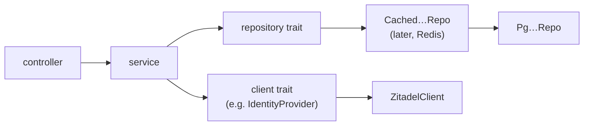

# Backend structure

Applies to every Rust service (`services/api` first). Organized **by feature**,
with the same layers inside each feature.

```text
services/api/src/
├── main.rs              start the server
├── app.rs               build repos/clients/services once, mount every feature's routes
├── config.rs            env vars (+ .env)
├── common/              only what every feature needs
│   ├── error.rs         ApiError → JSON { code, message }; RepoError
│   ├── db.rs            Postgres pool + migrations
│   ├── redis.rs         Redis connection (presence, caches later)
│   ├── user_limits.rs   per-user rate limits + sockets-per-user cap, in Redis
│   ├── shutdown.rs      graceful shutdown: stop signal + live socket count
│   └── middleware/
│       ├── auth.rs      AuthUser extractor (Bearer access token)
│       └── rate_limit.rs
└── features/
    ├── auth/            register, login, refresh, logout
    ├── users/           /me, profile + avatar, /users/{id}, /users/search (see profiles.md)
    ├── friends/         /friends: requests, accept, remove (see friends.md)
    ├── presence/        online / idle / offline, Redis (see presence.md)
    ├── health/          /health, /metrics
    └── gateway/         WebSocket (parked)
```

Each feature folder:

| File            | Job                                                                |
| --------------- | ------------------------------------------------------------------ |
| `mod.rs`        | `routes()`: the feature's endpoints                                |
| `controller.rs` | HTTP in/out only: parse, call the service, return JSON             |
| `service.rs`    | Business logic. No SQL, no HTTP                                    |
| `repository.rs` | Data access: a **trait** + a Postgres implementation               |
| `dto.rs`        | Request/response JSON shapes                                       |
| `models.rs`     | Domain structs                                                     |
| (extra)         | Feature-specific pieces, e.g. `auth/identity.rs`, `auth/tokens.rs` |

## Layers



## Rules

1. **Controllers** never touch the DB or external services. They call one service method.
2. **Services** depend on **traits** (`Arc<dyn UserRepo>`), never on concrete types.
3. **Repositories** return `RepoError` (e.g. `Conflict` for unique violations), not HTTP errors.
4. **Caching is a decorator:** `CachedUserRepo` implements `UserRepo` and wraps `PgUserRepo`. Services don't change.
5. Each feature owns its **models and DTOs**. Share only through `common/`.
6. Features use each other **through traits** (e.g. `auth` uses `users::UserRepo`), never each other's tables.
7. Everything is wired once in `app.rs`.
8. **Never log secrets.** Request types holding passwords implement `Debug` with `<redacted>`.

## Adding a feature

1. Create `features/<name>/` with the files above.
2. Add a migration in `services/api/migrations/` if it needs tables.
3. Expose `routes()` and merge it in `app.rs`.
4. Unit-test the service with fake repos; add checks to a `scripts/smoke-*.sh`.
5. Add integration tests in `services/api/tests/integration/` (see below).

## Shutdown and limits

- **Graceful shutdown** (`main.rs`, `common/shutdown.rs`). On SIGTERM or Ctrl-C:
  1. `axum::serve` stops accepting and lets in-flight HTTP requests finish.
  2. `Shutdown::trigger()` signals active gateway sessions through a Tokio `watch` channel. They send close code 1012 so clients reconnect.
  3. Axum does not track upgraded sockets. Each socket holds a `SocketGuard` that lowers the live count when dropped. After HTTP drains, `main` waits up to 10s for the count to reach zero.
- **Body size.** Axum body extractors such as `Json` enforce a 1 MiB default. Upload handlers read the raw body with their own caps. Whole attachments are capped by `ATTACHMENT_MAX_BYTES`.
- **Rate limits.**
  - `middleware/rate_limit.rs` keeps per-instance limits in memory and keys them by IP or user.
  - `user_limits.rs` shares per-user limits across instances. A Redis Lua script updates each counter and its expiry atomically. When a limit is reached, HTTP returns `429` with `Retry-After` and WebSockets return `retry_after_ms`. See [protocol.md](protocol.md#rate-limits).

## Testing

Three kinds of tests:

| Kind              | Where                              | Needs infra? | Run with                                              |
| ----------------- | ---------------------------------- | ------------ | ----------------------------------------------------- |
| Unit              | `#[cfg(test)]` in each `src/` file | No           | `cargo test -p api`                                   |
| Integration       | `services/api/tests/integration/`  | Yes          | `cargo test -p api --test integration -- --ignored`   |
| Load (WebSockets) | `tools/loadtest/`                  | Yes          | `scripts/loadtest.sh`                                 |

Start the infra first: `docker compose -f infra/docker-compose.yml up -d postgres scylla nats redis minio`.

### Integration tests

- They are `#[ignore]`d, so plain `cargo test` stays fast and needs no Docker.
- `--ignored` runs them. They start the **real** router in-process on a random port, with real Postgres, Scylla, NATS, Redis and MinIO.
- Each run makes its own Postgres database and Scylla keyspace, named `api_it_<unix time>_<random>`, so dev data is never touched and two runs at once don't clash. Leftovers older than 1 hour are dropped at the start of the next run.
- Rate limits stay **on**, like in production. The tests send few enough requests to stay under them.
- **Users are seeded straight into Postgres** and given tokens signed with a throwaway key. No Zitadel, no `/auth/register`, so the 5/min register limit never applies.
- Files: `harness.rs` (server, `seed_user`, WebSocket `Client`), `messages.rs`, `groups.rs`, `friends.rs`.
- `Client::connect` logs in, then sends a `Ping` and waits for the `Pong`. The server replies only after it has subscribed the socket to pushes, so the test never acts too early.
- `Client::request` sends one frame and waits for the reply with the same `id`. Pushes that arrive meanwhile are kept, so `client.push(...)` can find them later.
- `no_push` checks nothing arrived for 0.5s. A socket that closes counts as a failure, not as "no push".
- Overrides: `IT_DATABASE_URL` (admin URL, default the compose Postgres), `SCYLLA_NODES`, `NATS_URL`, `REDIS_URL`, `S3_ENDPOINT`.
- CI runs them in the `integration` job (`.github/workflows/ci.yml`), using the same compose file.

### Load test

`scripts/loadtest.sh` does it all:

1. Builds `api` and `loadtest` in release mode.
2. Resets a separate **`loadtest`** database and keyspace.
3. Starts its own api on **port 7171** (`MACHINE_ID=11`), with telemetry off, `RATE_LIMITS=off` and a throwaway signing key. If the port is already in use, it stops before doing anything, so it never sends traffic to another api (like the dev one on 7170).
4. For each step (default `100,250,500,1000` sockets), seeds users in pairs. Then every socket at once: connects, authenticates, opens a DM with its partner and sends `LT_MESSAGES` (default 5) messages.
5. Prints p50/p95/p99 for connect, auth, send→ack and send→partner delivery. It also prints failures per phase (connect, auth, open_dm, send, delivery) and errors by kind. `fail/ops` counts every attempted step, and each message is counted as delivered once, by its id.
6. Says where it **breaks**: the first step with errors over 1% or p99 ack over 1s.
7. Stops the api it started.

Knobs: `LT_STEPS=50,2000`, `LT_MESSAGES=10`, `LT_PORT=7181`.
