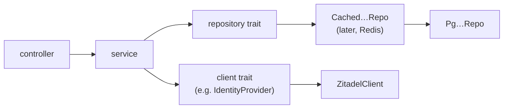

# Backend structure

Applies to every Rust service (`services/api` first). Organized **by feature**,
with the same layers inside each feature.

```text
services/api/src/
├── main.rs              start the server
├── app.rs               build repos/clients/services once, mount every feature's routes
├── config.rs            env vars (+ .env)
├── common/              only what every feature needs
│   ├── error.rs         ApiError → JSON { code, message }; RepoError
│   ├── db.rs            Postgres pool + migrations
│   └── middleware/
│       ├── auth.rs      AuthUser extractor (Bearer access token)
│       └── rate_limit.rs
└── features/
    ├── auth/            register, login, refresh, logout
    ├── users/           /me, /me/username, /users/search
    ├── friends/         /friends: requests, accept, remove (see friends.md)
    ├── presence/        online / idle / offline, Redis (see presence.md)
    ├── health/          /health, /metrics
    └── gateway/         WebSocket (parked)
```

Each feature folder:

| File            | Job                                                                |
| --------------- | ------------------------------------------------------------------ |
| `mod.rs`        | `routes()`: the feature's endpoints                                |
| `controller.rs` | HTTP in/out only: parse, call the service, return JSON             |
| `service.rs`    | Business logic. No SQL, no HTTP                                    |
| `repository.rs` | Data access: a **trait** + a Postgres implementation               |
| `dto.rs`        | Request/response JSON shapes                                       |
| `models.rs`     | Domain structs                                                     |
| (extra)         | Feature-specific pieces, e.g. `auth/identity.rs`, `auth/tokens.rs` |

## Layers



## Rules

1. **Controllers** never touch the DB or external services. They call one service method.
2. **Services** depend on **traits** (`Arc<dyn UserRepo>`), never on concrete types.
3. **Repositories** return `RepoError` (e.g. `Conflict` for unique violations), not HTTP errors.
4. **Caching is a decorator:** `CachedUserRepo` implements `UserRepo` and wraps `PgUserRepo`. Services don't change.
5. Each feature owns its **models and DTOs**. Share only through `common/`.
6. Features use each other **through traits** (e.g. `auth` uses `users::UserRepo`), never each other's tables.
7. Everything is wired once in `app.rs`.
8. **Never log secrets.** Request types holding passwords implement `Debug` with `<redacted>`.

## Adding a feature

1. Create `features/<name>/` with the files above.
2. Add a migration in `services/api/migrations/` if it needs tables.
3. Expose `routes()` and merge it in `app.rs`.
4. Unit-test the service with fake repos; add checks to a `scripts/smoke-*.sh`.
