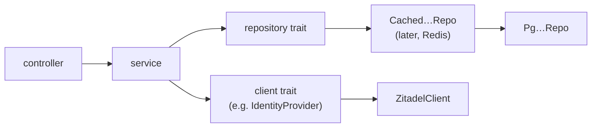

# Backend structure

Applies to every Rust service (`services/api` first). Organized **by feature**,
with the same layers inside each feature.

```text
services/api/src/
├── main.rs              start the server
├── app.rs               build repos/clients/services once, mount every feature's routes
├── config.rs            env vars (+ .env)
├── common/              only what every feature needs
│   ├── error.rs         ApiError → JSON { code, message }; RepoError
│   ├── db.rs            Postgres pool + migrations
│   ├── redis.rs         Redis connection (presence, caches later)
│   └── middleware/
│       ├── auth.rs      AuthUser extractor (Bearer access token)
│       └── rate_limit.rs
└── features/
    ├── auth/            register, login, refresh, logout
    ├── users/           /me, profile + avatar, /users/{id}, /users/search (see profiles.md)
    ├── friends/         /friends: requests, accept, remove (see friends.md)
    ├── presence/        online / idle / offline, Redis (see presence.md)
    ├── health/          /health, /metrics
    └── gateway/         WebSocket (parked)
```

Each feature folder:

| File            | Job                                                                |
| --------------- | ------------------------------------------------------------------ |
| `mod.rs`        | `routes()`: the feature's endpoints                                |
| `controller.rs` | HTTP in/out only: parse, call the service, return JSON             |
| `service.rs`    | Business logic. No SQL, no HTTP                                    |
| `repository.rs` | Data access: a **trait** + a Postgres implementation               |
| `dto.rs`        | Request/response JSON shapes                                       |
| `models.rs`     | Domain structs                                                     |
| (extra)         | Feature-specific pieces, e.g. `auth/identity.rs`, `auth/tokens.rs` |

## Layers



## Rules

1. **Controllers** never touch the DB or external services. They call one service method.
2. **Services** depend on **traits** (`Arc<dyn UserRepo>`), never on concrete types.
3. **Repositories** return `RepoError` (e.g. `Conflict` for unique violations), not HTTP errors.
4. **Caching is a decorator:** `CachedUserRepo` implements `UserRepo` and wraps `PgUserRepo`. Services don't change.
5. Each feature owns its **models and DTOs**. Share only through `common/`.
6. Features use each other **through traits** (e.g. `auth` uses `users::UserRepo`), never each other's tables.
7. Everything is wired once in `app.rs`.
8. **Never log secrets.** Request types holding passwords implement `Debug` with `<redacted>`.

## Adding a feature

1. Create `features/<name>/` with the files above.
2. Add a migration in `services/api/migrations/` if it needs tables.
3. Expose `routes()` and merge it in `app.rs`.
4. Unit-test the service with fake repos; add checks to a `scripts/smoke-*.sh`.
5. Add integration tests in `services/api/tests/integration/` (see below).

## Testing

Three kinds of tests:

| Kind              | Where                              | Needs infra? | Run with                                              |
| ----------------- | ---------------------------------- | ------------ | ----------------------------------------------------- |
| Unit              | `#[cfg(test)]` in each `src/` file | No           | `cargo test -p api`                                   |
| Integration       | `services/api/tests/integration/`  | Yes          | `cargo test -p api --test integration -- --ignored`   |
| Load (WebSockets) | `tools/loadtest/`                  | Yes          | `scripts/loadtest.sh`                                 |

Start the infra first: `docker compose -f infra/docker-compose.yml up -d postgres scylla nats redis minio`.

### Integration tests

- They are `#[ignore]`d, so plain `cargo test` stays fast and needs no Docker.
- `--ignored` runs them. They start the **real** router in-process on a random port, with real Postgres, Scylla, NATS, Redis and MinIO.
- They use their own **`api_it`** Postgres database and **`api_it`** Scylla keyspace. Both are dropped and recreated at the start of every run, so dev data is never touched. Don't run two copies at the same time.
- **Users are seeded straight into Postgres** and given tokens signed with a throwaway key. No Zitadel, no `/auth/register`, so the 5/min register limit never applies.
- Files: `harness.rs` (server, `seed_user`, WebSocket `Client`), `messages.rs`, `groups.rs`, `friends.rs`.
- `Client::request` sends one frame and waits for the reply with the same `id`. Pushes that arrive meanwhile are kept, so `client.push(...)` can find them later. `no_push` checks nothing arrived for 0.5s.
- Overrides: `IT_DATABASE_URL` (admin URL, default the compose Postgres), `SCYLLA_NODES`, `NATS_URL`, `REDIS_URL`, `S3_ENDPOINT`.
- CI runs them in the `integration` job (`.github/workflows/ci.yml`), using the same compose file.

### Load test

`scripts/loadtest.sh` does it all:

1. Builds `api` and `loadtest` in release mode.
2. Resets a separate **`loadtest`** database and keyspace.
3. Starts its own api on **port 7171** (`MACHINE_ID=11`), with telemetry off and a throwaway signing key. It does not touch the api on 7170.
4. For each step (default `100,250,500,1000` sockets), seeds users in pairs. Then every socket at once: connects, authenticates, opens a DM with its partner and sends `LT_MESSAGES` (default 5) messages.
5. Prints p50/p95/p99 for connect, auth, send→ack and send→partner delivery, plus errors by kind.
6. Says where it **breaks**: the first step with errors over 1% or p99 ack over 1s.
7. Stops the api it started.

Knobs: `LT_STEPS=50,2000`, `LT_MESSAGES=10`, `LT_PORT=7181`.
