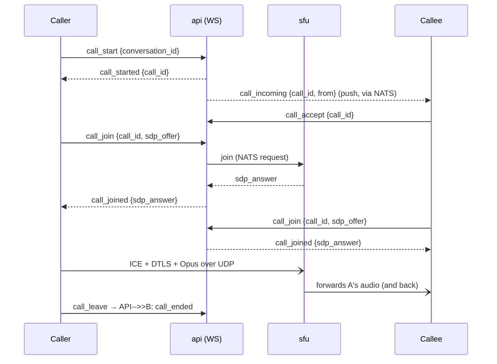

# Calls (design)

Status: **1:1 audio works** (Nov 2026): api signaling + `services/media` SFU + test UI.
Not yet: 3+ people, call history, TURN, desktop (libwebrtc), video.
Builds on [voice-video.md](voice-video.md) (media pipelines) and [protocol.md](protocol.md) (Envelope).
This doc covers: which SFU, how signaling works, the call flow, new messages, and the first spike.

## Words used here

- **SFU** (Selective Forwarding Unit): server that receives each person's media and forwards it to the others. It never decodes.
- **Signaling:** the setup chat before media flows (ring, accept, "here is how to reach me"). Rides our WebSocket.
- **SDP offer/answer:** a text blob each side sends: "I can do Opus, here are my keys". One side offers, the other answers.
- **ICE candidate:** an address (IP:port) where a side might be reachable. Both sides try pairs until one works.
- **STUN:** "what is my public IP?" service. **TURN:** a relay when no direct path works.
- **ICE-lite:** a simple ICE mode for servers with a public IP. They only answer, never probe.
- **Sans-IO:** a library that does no networking itself. You feed it packets and time; it hands back packets to send.

## 1. SFU choice

| Option | What it is | Verdict |
| --- | --- | --- |
| **str0m** (0.21) | Sans-IO WebRTC in Rust. Sync, no threads. Used by others for SFUs (e.g. `oxpulse-sfu-kit`). | **Pick.** Small, fits our Rust stack, we control the loop. |
| webrtc-rs `sfu` (0.20 rc) | New sans-IO SFU crate, July 2026. | Watch. Still a release candidate. Plan B. |
| LiveKit server (Go) | Full SFU + rooms + TURN, battle tested. | Fastest to a demo, but a second language and its own signaling. Plan C if str0m fails the gate. |
| mediasoup (C++/Node) | Mature SFU library. | No. Node control layer, not our stack. |

Why str0m: we need little (forward Opus, later forward video layers). Sans-IO means we write the UDP loop with tokio ourselves. That is more code, but easy to test and to observe (OTel spans per peer).

## 2. What runs where

| Piece | Runs in | Job |
| --- | --- | --- |
| `api` (existing) | axum + WS | Ring, accept, decline. Relays SDP between client and SFU. Checks who may join. |
| NATS (existing) | between servers | `api` ↔ `sfu` messages: `sfu.<id>.join`, `sfu.<id>.leave`. Ring pushes to the callee's api server. |
| **`sfu`** (new binary) | own process, public IP, UDP | One str0m `Rtc` per participant. Forwards RTP inside a room. |
| Postgres | — | Call log later (who, when, how long). Not needed for the spike. |
| Desktop client | Tauri Rust core | libwebrtc (LiveKit `libwebrtc` crate): mic, AEC, Opus, playback. Webview only shows UI. |
| Web client | browser | `RTCPeerConnection` + `getUserMedia`. Browser does Opus, AEC, playback. |

- Call state (ringing, who is in) lives **in memory in the SFU** for the MVP. Lost on restart; clients just rejoin.
- One SFU process is enough for the MVP. Many SFUs later: `api` picks one per call and stores `call_id → sfu_id`.

## 3. Network: STUN / TURN

- The SFU has a public IP, so clients need no STUN to reach it.
- **Use full ICE, not ICE-lite**, for now. The spike broke with lite on a machine with Docker bridges: Chrome sent media from `192.168.192.1`, str0m-lite had picked `192.168.1.88`, so ~97% of packets were dropped. Full ICE fixed it. Revisit lite in production (public IP, one interface).
- UDP blocked (corporate wifi): ~a few % of users. Fix later with **ICE over TCP/443** on the SFU or a **coturn** in front. Not in the spike.
- coturn becomes required when P2P arrives (after MVP). Credentials: short-lived HMAC ("TURN REST") issued by `api`.

## 4. Call flow



Step by step:

1. **Ring.** A sends `call_start`. `api` creates `call_id`, pushes `call_incoming` to every device of B.
2. **Accept / decline.** First device of B to accept wins; others get `call_ended {reason: answered_elsewhere}`. No answer in 30 s → `missed`.
3. **Join.** Each client builds a PeerConnection, makes an SDP offer, sends `call_join`. `api` checks membership, asks the SFU, returns the answer.
4. **Media.** Client connects straight to the SFU over UDP. The SFU forwards each audio track to the other members.
5. **New tracks later** (screen share on/off): client sends a new offer with `call_renegotiate`. The SFU may also push `call_renegotiate` (someone joined).
6. **Leave / drop.** `call_leave`, or the WS dies, or the SFU sees no packets for 15 s → others get `participant_left`. Last one out ends the call.

Trickle ICE (sending candidates one by one) is not needed: the SFU puts its one candidate in the answer, and clients find the SFU without extra candidates. Add `ice_candidate` only for P2P later.

## 5. Protobuf messages

Client ↔ api: `proto/v1/calls.proto`. **Envelope fields 100–139 are reserved for calls.**

| Envelope field | Message | Direction |
| --- | --- | --- |
| 100 | `CallStart {conversation_id}` | request → `CallResult` (existing call if one is going) |
| 101 | `CallAccept {call_id}` | request → `CallResult` |
| 102 | `CallDecline {call_id}` | request → `CallResult` |
| 103 | `CallJoin {call_id, sdp_offer}` | request → `CallJoined {call, sdp_answer}` |
| 105 | `CallLeave {call_id}` | request → `CallResult` |
| 120 | `CallResult {call}` | reply |
| 121 | `CallJoined {call, sdp_answer}` | reply |
| 130 | `CallIncoming {call}` | push: ring |
| 131 | `CallUpdated {call}` | push: accepted, someone joined/left |
| 133 | `CallEnded {call_id, conversation_id, reason}` | push: `hangup`, `declined`, `missed` |

`Call` = `{id, conversation_id, caller_id, state (ringing/active), participant_ids}`.
Free for later: 104 (renegotiate, for 3+ people), 106 (mute status), 132.

api ↔ media (internal, NATS): `proto/v1/media.proto`.

| Subject | Message |
| --- | --- |
| `media.join` (request/reply) | `MediaJoin {room_id, sdp_offer}` → `MediaJoinReply {peer_id, sdp_answer, error}` |
| `media.leave` (publish) | `MediaLeave {peer_id}` |

Rules (in `features/calls/service.rs`):

- One live call per conversation. `call_start` on a busy one returns it.
- The callee joining counts as accepting. Nobody answers in 30 s → `missed`.
- The call ends when nobody is left to talk to (after it was answered, one person left = end).
- **One audio device per user** (checked atomically). A 2nd device gets `already_in_call`. Extra devices with roles (e.g. a screen-only tablet) come with issue #12.
- A socket closing removes **that socket's** participation (two tabs can share a device id).
- "Missed" / "declined" only end a call that is **still ringing**, checked in the same step as the removal (an accept at the same moment wins).
- Calls live **in memory in the api**: correct with one api server only. Several → move `CallStore` to Redis.

## How to run

```sh
cargo run -p media                  # MEDIA_IP=<tailscale ip> to call across devices; UDP port 7110
cargo run -p api                    # as usual
scripts/smoke-calls.sh              # end-to-end check (needs the client dev server on :7104)
```

## 6. Audio settings (Opus)

- 48 kHz, 20 ms frames, mono for voice.
- In-band **FEC on**, **DTX on** (send almost nothing in silence), target 64 kbps. Set via SDP `fmtp`: `useinbandfec=1;usedtx=1;maxaveragebitrate=64000`.
- Echo cancellation, noise suppression, auto gain: browser built-ins (`getUserMedia` constraints) on web; libwebrtc APM on desktop.
- Speaking indicator: client-side audio level, or the RTP `audio-level` header extension read by the SFU (cheap, no decode).

## 7. Web vs desktop client

| | Web build | Tauri desktop |
| --- | --- | --- |
| WebRTC | browser | libwebrtc in Rust core (LiveKit crates, libwebrtc m144) |
| Mic / speakers | `getUserMedia` / `<audio>` | libwebrtc audio device module |
| Screen share | `getDisplayMedia`, usually ~30fps, browser picks codec | native capture + HW encode, 1080p60 |
| Risk | low | build size, C++ toolchain, Linux Wayland needs `glib-main-loop` feature |

The SFU doesn't care which client it talks to. A `Platform`/`MediaTransport` trait hides the difference in the app.

## 8. Later: 1080p60 screen share

- Bitrate: ~6–8 Mbps H.264, ~4–5 Mbps AV1. Uplink must hold it, so add **simulcast** (e.g. 1080p60 + 720p30) and let the SFU pick per viewer.
- SFU needs: forward video, pick simulcast layer per viewer, react to **PLI/FIR** (viewer asks "send me a full frame"), pass **TWCC** feedback (bandwidth estimate). str0m supports these; we write the layer-picking logic.
- Desktop: native capture (DXGI / ScreenCaptureKit / PipeWire) → HW encoder → libwebrtc as a custom video source. This is the gate prototype.
- Contentful mode: set `contentHint = "detail"` / degradation preference "maintain-framerate" for games.

## 9. Risks / open questions

1. **libwebrtc in Tauri** is heavy (prebuilt C++ binaries, big app). Must work on Windows, macOS, Linux.
2. **str0m SFU logic is ours**: rooms, layer switching, bandwidth. More work than LiveKit. Keep LiveKit as plan C.
3. **UDP-blocked users** can't call until ICE-TCP or TURN exists.
4. **Hardware encode into libwebrtc** at 60fps is unproven (the gate).
5. **SFU scaling**: one process now. Later needs SFU selection and cascading.
6. **E2E for calls** (SFrame / insertable streams) not in MVP. Without it, our SFU decrypts SRTP, so it could read the media.
7. Ring on many devices + glare (both call at once): pick "join the existing call" rule.

## 10. First spike: 1:1 audio through our SFU

✅ Done. Steps 1–8 are now real code (`services/media`, `features/calls`). Step 9 is next.

Goal: two browser tabs talk through our `str0m` SFU, signaling over our WebSocket. The spike folder was deleted once this became real code (see git history: `7e874e8`).

1. New crate `spikes/sfu-audio/sfu`: tokio UDP socket + str0m, based on str0m's `chat.rs` example. One room.
2. SFU exposes `join(sdp_offer) -> sdp_answer`. For the spike, plain HTTP POST on the SFU (skip NATS).
3. Forward every audio packet from one peer to the other. No decode.
4. Static HTML page: `getUserMedia({audio:true})` → offer → POST → set answer → play remote track.
5. Test: two tabs on one machine, then two machines on the LAN. Listen for echo and delay.
6. Measure: CPU of SFU, round-trip delay (clap test), packet loss in `chrome://webrtc-internals`.
7. Swap the HTTP POST for `call_join` over our WebSocket + NATS (proto fields 100+). Still in the spike folder.
8. Add ring/accept (`call_start`, `call_incoming`, `call_accept`) in the test chat screen.
9. Second spike (the gate): replace one tab with the Tauri app using LiveKit's `libwebrtc` crate.

Done when: two users hear each other clearly for 10 minutes, delay under 150 ms on LAN, SFU under 5% CPU.
Then write down: keep str0m, or switch to webrtc-rs `sfu` / LiveKit.

## Sources

- str0m: https://docs.rs/crate/str0m/latest
- webrtc-rs SFU announcement (Jul 2026): https://webrtc.rs/blog/2026/07/13/announcing-sfu-v0.20.0-rc.3
- str0m SFU kit: https://docs.rs/crate/oxpulse-sfu-kit/latest
- LiveKit Rust SDK releases (m144, Wayland feature): https://releases.sh/livekit/livekit-rust-sdks/highlights
