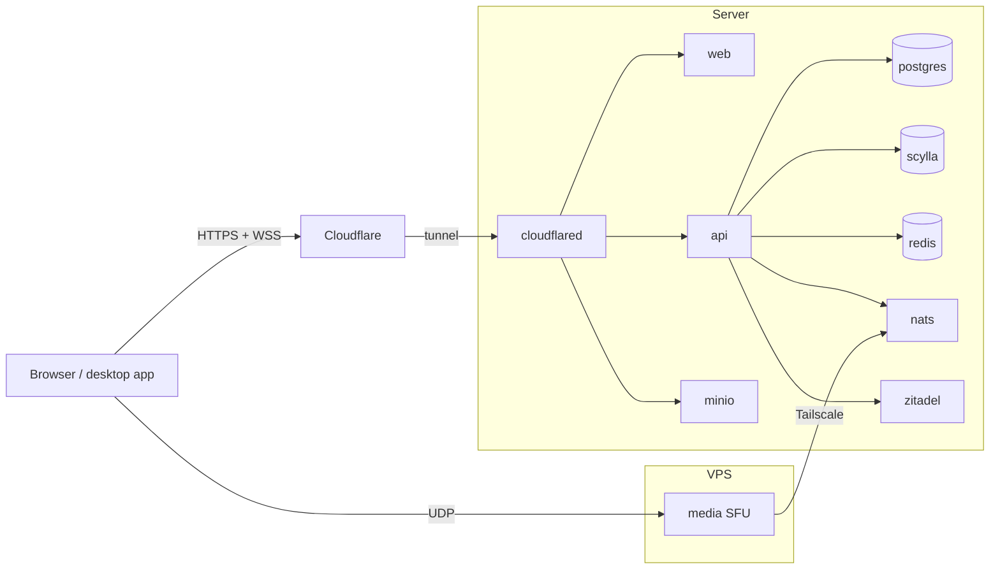

# Deployment (prod)

Two machines:

| Machine | Runs | Compose project |
|---|---|---|
| **Server** (main box, at home) | web, api, zitadel, postgres, scylla, redis, nats, minio, cloudflared | `discord2-prod` |
| **VPS** | media (voice/video SFU) | `discord2-media` |

The Compose projects keep the old `discord2-*` names. Renaming them would start
a second, empty stack.

- The server opens **no public ports**. Cloudflare Tunnel is the only way in.
- The VPS opens **one public UDP port** for voice/video, because Cloudflare
  Tunnel can't carry UDP.
- The VPS talks to NATS on the server over **Tailscale** (private VPN).
  NATS is published only on the server's Tailscale IP.



| Public hostname | Tunnel service |
|---|---|
| `app.<domain>` | `http://web:80` |
| `api.<domain>` | `http://api:7100` (HTTP + WebSocket) |
| `files.<domain>` | `http://minio:9000` (file downloads) |

Write the service literally as `web:80`. cloudflared runs inside the same
Docker network, so Docker service names resolve. Zitadel stays internal.

## Secrets

- `infra/prod/.env` (server) and `infra/prod/media/.env` (VPS).
  Templates: the `.env.example` next to each.
- Git-ignored. Never commit. `chmod 600`.
- Generate passwords with `openssl rand -hex 24`.
- `NATS_PASSWORD` must be **the same** in both files.
- The api's PAT and signing key are made automatically on first boot
  (`secrets-init` + Zitadel) and live in the `secrets` volume.
  Losing that volume logs everyone out.

## 1. Cloudflare (once)

1. Add the domain to Cloudflare and switch nameservers at the registrar.
2. Zero Trust → Networks → Tunnels → Create (cloudflared). Copy the token
   into `TUNNEL_TOKEN` in the server `.env`.
3. Add the 3 public hostnames above (type HTTP).
4. No Cloudflare Access policy: it would block the desktop app.

## 2. Tailscale (once)

Install on both machines:
```sh
curl -fsSL https://tailscale.com/install.sh | sh
sudo tailscale up --ssh --advertise-tags=tag:servers   # server
sudo tailscale up --ssh --advertise-tags=tag:vps       # VPS
tailscale ip -4                                         # note it
```

Policy (admin console → Access controls), the parts that matter:
- `acls`: you → everything; `tag:vps` → `tag:servers:4222` (NATS only);
  `tag:servers` → `tag:vps:22`.
- `ssh`: you → both as root; `tag:servers` → `tag:vps` as root.
- No other users get access. Keep the `tests` block: it refuses a save that
  would open NATS wider or let others SSH in.

SSH is Tailscale SSH (no keys): from the server, `ssh root@<vps tailscale ip>`.
Password SSH on the VPS is disabled.

## 3. Server

Needs Docker + Compose.
```sh
cp infra/prod/.env.example infra/prod/.env       # fill in, TAILSCALE_IP = server's
docker compose -f infra/prod/compose.yml --env-file infra/prod/.env up -d --build
docker compose -f infra/prod/compose.yml --env-file infra/prod/.env ps
```
First boot takes a few minutes: Zitadel sets itself up, then the api starts.

Nightly backups: cron `infra/prod/backup.sh`.

## 4. VPS (media)

Needs Docker + Compose, and the public IP on its own network interface
(`ip a` shows it). No GitHub on the VPS. Ship code from the server:

**On the server** (building on the VPS is very slow, so build here):
```sh
docker compose -f infra/prod/media/compose.yml --env-file infra/prod/media/.env build
docker save discord2-media-media:latest | gzip > ~/adept-media-image.tar.gz
tar czf ~/adept-media.tar.gz infra/prod/media     # first time: compose + .env
scp ~/adept-media.tar.gz ~/adept-media-image.tar.gz root@<vps>:/opt/
```

**On the VPS**:
```sh
mkdir -p /opt/discord2 && cd /opt/discord2
tar xzf ../adept-media.tar.gz                     # first time / config change
gunzip -c ../adept-media-image.tar.gz | docker load
docker compose -f infra/prod/media/compose.yml --env-file infra/prod/media/.env up -d --force-recreate
docker compose -f infra/prod/media/compose.yml logs --tail 20
```
Healthy log: `media UDP listening`, then `media ready`.

Media `.env`: `MEDIA_IP` = VPS public IP, `MEDIA_PORT` = the UDP port,
`MAIN_TAILSCALE_IP` = server's Tailscale IP, `NATS_PASSWORD` = same as server.

## 5. Release the desktop app

The Release app workflow builds a Windows x64 installer and publishes it to this repository's GitHub Releases. Linux builds are paused. The installed app checks GitHub Releases and asks the user before it installs a new version. Installed apps download anonymously, so the repository must be public before you publish.

### Set up release signing

1. Run `pnpm --filter client tauri signer generate --write-keys /secure/path/adept.key`. Back up the private key and password. Installed apps use the matching public key to verify future updates.
2. Set the Actions variable `TAURI_UPDATER_PUBLIC_KEY` to the contents of `adept.key.pub`. The workflow also uses `PROD_API_HTTP` and `PROD_API_WS`.
3. Set `TAURI_SIGNING_PRIVATE_KEY` and `TAURI_SIGNING_PRIVATE_KEY_PASSWORD` as secrets in the `desktop-release` Actions environment. Set the environment's deployment branches to the refs authorized to sign builds.

### Build and publish

1. Bump `version` in `client/src-tauri/tauri.conf.json` for each release. Promote the commit to `prod`.
2. Run **Release app** from `prod` with `create_draft` selected. Enter the release notes to show in the app. Leave `create_draft` clear to generate signed workflow artifacts only.
3. Verify the draft includes the installer, its signature, and `latest.json`. Publish it as the latest stable release when verification passes.
4. For the first rollout, share the installer with existing users for a manual upgrade. Later releases appear in **Check for updates**.

### Old update feed (`adept-releases`)

v0.1.0 was published to the separate repository `IuriGuerreiro/adept-releases`, and that version checks it for updates. After each release here, copy its `latest.json` there so those installs still find the update. The download URLs inside it point to this repository:

```sh
gh release download "v$VERSION" -R IuriGuerreiro/riftnet -p latest.json -D /tmp/feed
gh release create "v$VERSION" /tmp/feed/latest.json -R IuriGuerreiro/adept-releases \
  --title "Riftnet v$VERSION" --notes "Moved to https://github.com/IuriGuerreiro/riftnet/releases"
```

Archive `adept-releases` once no one runs v0.1.0.

For an end-to-end test, run the workflow from a public fork with its own signing key. Install the lower version, then expose the higher version on the test feed. Verify **Later**, the install and restart, settings persistence, and rejection of a mismatched signature. If a published build needs to be reverted, ship the previous working code with a higher version.

## Update / redeploy

- **API and media**: merge `main` into `prod`. The **Deploy** workflow does the rest.
- **Web**: not automated. On the server: `up -d --build --no-deps web`.
- **Desktop app**: see section 5.
- Changing the domain: rebuild `web` and the desktop app (URLs baked in).

Always pass `--no-deps <service>`. A plain `up -d --build` would replace the
deployed API with a local build.

### What a deploy does

1. Run CI, then build both images and push them to private GHCR
   (GitHub's image registry).
2. Skip if `prod` already has a newer commit. Only one deploy runs at a time.
3. Join Tailscale with a short-lived OIDC login. No key is stored.
4. **API**: dump Postgres to `/var/backups/adept` (newest 14 kept), replace only
   `api`, check the container, then the public `/health`.
5. **Media**: only if the API deploy passed and the media fingerprint differs from
   the running container's. The fingerprint (`scripts/media-fingerprint.sh`) covers
   media code, its shared libs, protos and crates. A restart drops live calls.
   The check is `/ready`, which does a real NATS round trip.
6. If a check fails, put the old image back and fail the run.

**Migrations are not undone.** The old API starts on the newer database, so every
migration must work with the previous API version. Add columns first, remove them in
a later release. API images built before this pipeline refuse to start after a newer
migration, so ship no migration in the first automated deploy.

A changed Compose file or `.env` is not deployed by CI. Run the setup script again, then
`sudo /opt/adept-deploy/deploy.sh apply`. The workflow warns when the installed files are old.

### Set up automatic deploys (once)

1. **Server**. Use a checkout of this version and the live `.env`:

   ```sh
   sudo infra/prod/setup-deploy.sh api /path/to/live/infra/prod/.env
   ```

   The script also sets `ip_nonlocal_bind`, so NATS can start before Tailscale
   after a reboot. `.env` is used where it is. Keep that folder.

2. **VPS**. From the server checkout, then on the VPS:

   ```sh
   tar c infra/prod/setup-deploy.sh infra/prod/deploy.sh infra/prod/media/compose.yml infra/prod/media/compose.deploy.yml |
     ssh root@<vps> 'mkdir -p /root/adept-setup && tar x -C /root/adept-setup'
   ssh root@<vps> /root/adept-setup/infra/prod/setup-deploy.sh media /opt/discord2/infra/prod/media/.env
   ```

   Each script creates the `adept-deploy` user. Its only sudo right is running
   `/opt/adept-deploy/deploy.sh` without arguments.

3. **Tailscale policy**. Merge these in, keep the existing rules and `tests`:

   ```jsonc
   "tagOwners": { "tag:ci-deploy": ["autogroup:admin"] },
   "acls": [
     { "action": "accept", "src": ["tag:ci-deploy"], "dst": ["tag:servers:22", "tag:vps:22"] },
   ],
   "ssh": [
     { "action": "accept", "src": ["tag:ci-deploy"], "dst": ["tag:servers", "tag:vps"], "users": ["adept-deploy"] },
   ],
   ```

4. **Tailscale → Settings → Trust credentials → OpenID Connect → GitHub**:
   - Scope **Auth Keys: Write**, tag `tag:ci-deploy`.
   - Subject: `repo:IuriGuerreiro@128285759/riftnet@1456372594:ref:refs/heads/prod`
   - Claim `workflow_ref`: `IuriGuerreiro/riftnet/.github/workflows/deploy.yml@refs/heads/prod`

5. **GitHub repository variables**:

   | Variable | Value |
   |---|---|
   | `PROD_TAILSCALE_CLIENT_ID` | from the credential |
   | `PROD_TAILSCALE_AUDIENCE` | from the credential |
   | `PROD_API_DEPLOY_HOST` | server's Tailscale name |
   | `PROD_MEDIA_DEPLOY_HOST` | VPS's Tailscale name or IP |

### Roll back by hand

On the machine. The next push to `prod` deploys the new version again.

```sh
sudo /opt/adept-deploy/deploy.sh rollback
sudo cat /opt/adept-deploy/last-deploy.log     # what the last run did
```

## Troubleshooting

| Symptom | Cause |
|---|---|
| NATS runs but port 4222 is closed after a reboot | Docker dropped its network: `docker network connect discord2-prod_nats discord2-prod-nats-1` |
| Deploy: `Expected one ... container` | Wrong machine or project, or a hard-killed deploy left an extra `Created` container: remove only that one |
| NATS logs `authentication error` every minute | VPS runs an old media image, or `NATS_PASSWORD` differs |
| Media `Connection refused` to NATS | Tailscale down, or policy missing `tag:vps → tag:servers:4222` |
| `ssh: tailnet policy does not permit you` | `ssh` section of the Tailscale policy is missing the rule |
| Zitadel unhealthy on first boot | Half-finished setup: `down -v` (wipes data!) and start again |
| api `signing key not found` | `secrets-init` didn't run; check its logs |
