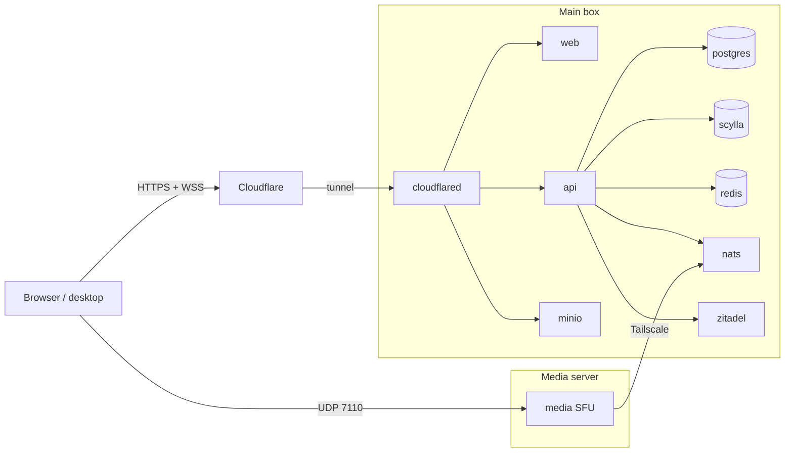

# Deployment (prod prototype)

Two machines. The main box has no open ports: Cloudflare Tunnel is the only
way in. The media server has one open UDP port, because Cloudflare Tunnel
can't carry public UDP (voice/video).



| Hostname | Goes to |
|---|---|
| `app.iuriguerreiro.dev` | `web:80` |
| `api.iuriguerreiro.dev` | `api:7100` (HTTP + WebSocket) |
| `files.iuriguerreiro.dev` | `minio:9000` (presigned downloads) |

Zitadel stays internal: only the api talks to it.

Docker networks: `edge` (cloudflared, web, api, minio), `data` (internal: dbs,
nats, zitadel), `storage` (internal: api ↔ minio), `nats` (only to publish
NATS on the Tailscale IP).

## Setup

1. **Domain**: add `iuriguerreiro.dev` to Cloudflare (change nameservers at the registrar).
2. **Tailscale**: install on both machines, note each `tailscale ip -4`.
3. **Tunnel**: Zero Trust → Networks → Tunnels → Create (cloudflared). Copy the token.
   Add the 3 public hostnames above (type HTTP, service = `web:80`, `api:7100`, `minio:9000`).
4. **Main box**:
   ```sh
   cp infra/prod/.env.example infra/prod/.env   # fill it in
   docker compose -f infra/prod/compose.yml --env-file infra/prod/.env up -d --build
   ```
   First boot: Zitadel makes the api's token (takes ~1 min), then the api starts.
5. **Media server** (needs a public IP on its network interface):
   ```sh
   cp infra/prod/media/.env.example infra/prod/media/.env   # fill it in
   docker compose -f infra/prod/media/compose.yml --env-file infra/prod/media/.env up -d --build
   ```
   Open UDP `7110` in its firewall.
6. **Backups**: cron `infra/prod/backup.sh` nightly on the main box.

## Notes

- No Cloudflare Access policy: it would block the desktop app and API calls.
  Protection is the app's own login.
- If the media server sits behind NAT (home router, or a cloud VM without the
  public IP on its interface), `MEDIA_IP` can't be bound. That needs a small
  change: bind `0.0.0.0` and advertise the public IP separately.
- Rebuild `web` when the domain changes: API URLs are baked in at build time.
