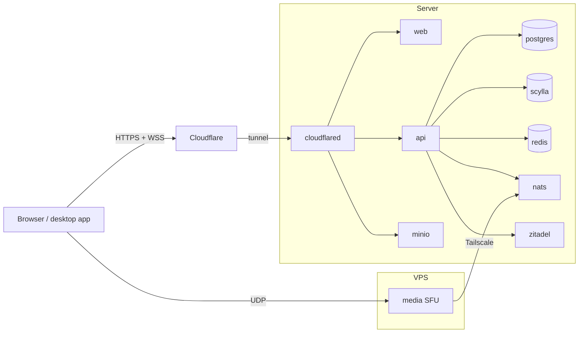

# Deployment (prod)

Two machines:

| Machine | Runs | Compose project |
|---|---|---|
| **Server** (main box, at home) | web, api, zitadel, postgres, scylla, redis, nats, minio, cloudflared | `discord2-prod` |
| **VPS** | media (voice/video SFU) | `discord2-media` |

- The server opens **no public ports**. Cloudflare Tunnel is the only way in.
- The VPS opens **one public UDP port** for voice/video, because Cloudflare
  Tunnel can't carry UDP.
- The VPS talks to NATS on the server over **Tailscale** (private VPN).
  NATS is published only on the server's Tailscale IP.



| Public hostname | Tunnel service |
|---|---|
| `app.<domain>` | `http://web:80` |
| `api.<domain>` | `http://api:7100` (HTTP + WebSocket) |
| `files.<domain>` | `http://minio:9000` (file downloads) |

Write the service literally as `web:80`. cloudflared runs inside the same
Docker network, so Docker service names resolve. Zitadel stays internal.

## Secrets

- `infra/prod/.env` (server) and `infra/prod/media/.env` (VPS).
  Templates: the `.env.example` next to each.
- Git-ignored. Never commit. `chmod 600`.
- Generate passwords with `openssl rand -hex 24`.
- `NATS_PASSWORD` must be **the same** in both files.
- The api's PAT and signing key are made automatically on first boot
  (`secrets-init` + Zitadel) and live in the `secrets` volume.
  Losing that volume logs everyone out.

## 1. Cloudflare (once)

1. Add the domain to Cloudflare and switch nameservers at the registrar.
2. Zero Trust → Networks → Tunnels → Create (cloudflared). Copy the token
   into `TUNNEL_TOKEN` in the server `.env`.
3. Add the 3 public hostnames above (type HTTP).
4. No Cloudflare Access policy: it would block the desktop app.

## 2. Tailscale (once)

Install on both machines:
```sh
curl -fsSL https://tailscale.com/install.sh | sh
sudo tailscale up --ssh --advertise-tags=tag:servers   # server
sudo tailscale up --ssh --advertise-tags=tag:vps       # VPS
tailscale ip -4                                         # note it
```

Policy (admin console → Access controls), the parts that matter:
- `acls`: you → everything; `tag:vps` → `tag:servers:4222` (NATS only);
  `tag:servers` → `tag:vps:22`.
- `ssh`: you → both as root; `tag:servers` → `tag:vps` as root.
- No other users get access. Keep the `tests` block: it refuses a save that
  would open NATS wider or let others SSH in.

SSH is Tailscale SSH (no keys): from the server, `ssh root@<vps tailscale ip>`.
Password SSH on the VPS is disabled.

## 3. Server

Needs Docker + Compose.
```sh
cp infra/prod/.env.example infra/prod/.env       # fill in, TAILSCALE_IP = server's
docker compose -f infra/prod/compose.yml --env-file infra/prod/.env up -d --build
docker compose -f infra/prod/compose.yml --env-file infra/prod/.env ps
```
First boot takes a few minutes: Zitadel sets itself up, then the api starts.

Nightly backups: cron `infra/prod/backup.sh`.

## 4. VPS (media)

Needs Docker + Compose, and the public IP on its own network interface
(`ip a` shows it). No GitHub on the VPS. Ship code from the server:

**On the server** (building on the VPS is very slow, so build here):
```sh
docker compose -f infra/prod/media/compose.yml --env-file infra/prod/media/.env build
docker save discord2-media-media:latest | gzip > ~/discord2-media-image.tar.gz
tar czf ~/discord2-media.tar.gz infra/prod/media     # first time: compose + .env
scp ~/discord2-media.tar.gz ~/discord2-media-image.tar.gz root@<vps>:/opt/
```

**On the VPS**:
```sh
mkdir -p /opt/discord2 && cd /opt/discord2
tar xzf ../discord2-media.tar.gz                     # first time / config change
gunzip -c ../discord2-media-image.tar.gz | docker load
docker compose -f infra/prod/media/compose.yml --env-file infra/prod/media/.env up -d --force-recreate
docker compose -f infra/prod/media/compose.yml logs --tail 20
```
Healthy log: `media UDP listening`, then `media ready`.

Media `.env`: `MEDIA_IP` = VPS public IP, `MEDIA_PORT` = the UDP port,
`MAIN_TAILSCALE_IP` = server's Tailscale IP, `NATS_PASSWORD` = same as server.

## 5. Desktop app (Windows)

In **Settings → Secrets and variables → Actions → Variables**, set `PROD_API_HTTP`
to the production HTTPS API URL and `PROD_API_WS` to the production WSS URL ending
in `/ws`. GitHub Actions embeds these URLs in the executable.

Merge `main` into `prod` to start **Release Windows app**. After CI passes, the
workflow builds `discord2-windows-x64.exe` and attaches it to a draft GitHub Release
tagged `windows-<commit SHA>`. Download the executable from the draft and verify
sign-in on Windows. Then publish the release.

### Build manually on the server

Built on the server (cross-compiled, no Windows needed):
```sh
cd client
VITE_API_HTTP=https://api.<domain> VITE_API_WS=wss://api.<domain>/ws \
  pnpm tauri build --runner cargo-xwin --target x86_64-pc-windows-msvc --no-bundle
```
Output is a bare `.exe`. Needs `cargo-xwin` and LLVM (`clang-cl`, `lld-link`)
on PATH. Revert any change the build makes to `src-tauri/Cargo.toml`.

## Update / redeploy

- **Server**: pull the `prod` branch, then the same `up -d --build`.
- **VPS**: repeat step 4 (build image → scp → load → `--force-recreate`).
- Changing the domain: rebuild `web` and the desktop app (URLs baked in).

## Troubleshooting

| Symptom | Cause |
|---|---|
| NATS logs `authentication error` every minute | VPS runs an old media image, or `NATS_PASSWORD` differs |
| Media `Connection refused` to NATS | Tailscale down, or policy missing `tag:vps → tag:servers:4222` |
| `ssh: tailnet policy does not permit you` | `ssh` section of the Tailscale policy is missing the rule |
| Zitadel unhealthy on first boot | Half-finished setup: `down -v` (wipes data!) and start again |
| api `signing key not found` | `secrets-init` didn't run; check its logs |
