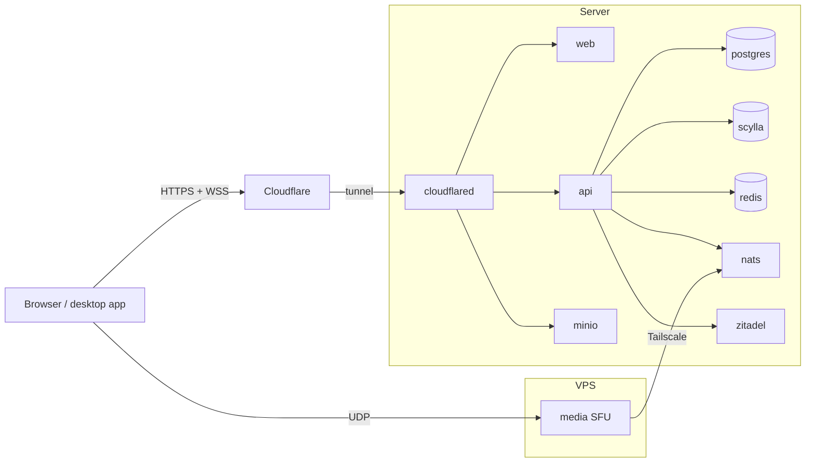

# Deployment (prod)

Two machines:

| Machine | Runs | Compose project |
|---|---|---|
| **Server** (main box, at home) | web, api, zitadel, postgres, scylla, redis, nats, minio, cloudflared | `discord2-prod` |
| **VPS** | media (voice/video SFU) | `discord2-media` |

- The server opens **no public ports**. Cloudflare Tunnel is the only way in.
- The VPS opens **one public UDP port** for voice/video, because Cloudflare
  Tunnel can't carry UDP.
- The VPS talks to NATS on the server over **Tailscale** (private VPN).
  NATS is published only on the server's Tailscale IP.



| Public hostname | Tunnel service |
|---|---|
| `app.<domain>` | `http://web:80` |
| `api.<domain>` | `http://api:7100` (HTTP + WebSocket) |
| `files.<domain>` | `http://minio:9000` (file downloads) |

Write the service literally as `web:80`. cloudflared runs inside the same
Docker network, so Docker service names resolve. Zitadel stays internal.

## Secrets

- `infra/prod/.env` (server) and `infra/prod/media/.env` (VPS).
  Templates: the `.env.example` next to each.
- Git-ignored. Never commit. `chmod 600`.
- Generate passwords with `openssl rand -hex 24`.
- `NATS_PASSWORD` must be **the same** in both files.
- The api's PAT and signing key are made automatically on first boot
  (`secrets-init` + Zitadel) and live in the `secrets` volume.
  Losing that volume logs everyone out.

## 1. Cloudflare (once)

1. Add the domain to Cloudflare and switch nameservers at the registrar.
2. Zero Trust → Networks → Tunnels → Create (cloudflared). Copy the token
   into `TUNNEL_TOKEN` in the server `.env`.
3. Add the 3 public hostnames above (type HTTP).
4. No Cloudflare Access policy: it would block the desktop app.

## 2. Tailscale (once)

Install on both machines:
```sh
curl -fsSL https://tailscale.com/install.sh | sh
sudo tailscale up --ssh --advertise-tags=tag:servers   # server
sudo tailscale up --ssh --advertise-tags=tag:vps       # VPS
tailscale ip -4                                         # note it
```

Policy (admin console → Access controls), the parts that matter:
- `acls`: you → everything; `tag:vps` → `tag:servers:4222` (NATS only);
  `tag:servers` → `tag:vps:22`.
- `ssh`: you → both as root; `tag:servers` → `tag:vps` as root.
- No other users get access. Keep the `tests` block: it refuses a save that
  would open NATS wider or let others SSH in.

SSH is Tailscale SSH (no keys): from the server, `ssh root@<vps tailscale ip>`.
Password SSH on the VPS is disabled.

## 3. Server

Needs Docker + Compose.
```sh
cp infra/prod/.env.example infra/prod/.env       # fill in, TAILSCALE_IP = server's
docker compose -f infra/prod/compose.yml --env-file infra/prod/.env up -d --build
docker compose -f infra/prod/compose.yml --env-file infra/prod/.env ps
```
First boot takes a few minutes: Zitadel sets itself up, then the api starts.

Nightly backups: cron `infra/prod/backup.sh`.

## 4. VPS (media)

Needs Docker + Compose, and the public IP on its own network interface
(`ip a` shows it). No GitHub on the VPS. Ship code from the server:

**On the server** (building on the VPS is very slow, so build here):
```sh
docker compose -f infra/prod/media/compose.yml --env-file infra/prod/media/.env build
docker save discord2-media-media:latest | gzip > ~/discord2-media-image.tar.gz
tar czf ~/discord2-media.tar.gz infra/prod/media     # first time: compose + .env
scp ~/discord2-media.tar.gz ~/discord2-media-image.tar.gz root@<vps>:/opt/
```

**On the VPS**:
```sh
mkdir -p /opt/discord2 && cd /opt/discord2
tar xzf ../discord2-media.tar.gz                     # first time / config change
gunzip -c ../discord2-media-image.tar.gz | docker load
docker compose -f infra/prod/media/compose.yml --env-file infra/prod/media/.env up -d --force-recreate
docker compose -f infra/prod/media/compose.yml logs --tail 20
```
Healthy log: `media UDP listening`, then `media ready`.

Media `.env`: `MEDIA_IP` = VPS public IP, `MEDIA_PORT` = the UDP port,
`MAIN_TAILSCALE_IP` = server's Tailscale IP, `NATS_PASSWORD` = same as server.

## 5. Desktop app

In **Settings → Secrets and variables → Actions → Variables**, set `PROD_API_HTTP`
to the production HTTPS API URL and `PROD_API_WS` to the production WSS URL ending
in `/ws`. GitHub Actions embeds these URLs in both builds.

Merge `main` into `prod` to start **Release app**. After CI and both builds pass,
the workflow attaches `discord2-windows-x64.exe` and `discord2-linux-x64.AppImage`
to a draft GitHub Release tagged `app-<commit SHA>`.

Download both files from the draft. On Linux, run
`chmod +x discord2-linux-x64.AppImage` before launching it. Verify sign-in on
both platforms, then publish the release.

### Build the Windows executable manually on the server

Built on the server (cross-compiled, no Windows needed):
```sh
cd client
VITE_API_HTTP=https://api.<domain> VITE_API_WS=wss://api.<domain>/ws \
  pnpm tauri build --runner cargo-xwin --target x86_64-pc-windows-msvc --no-bundle
```
Output is a bare `.exe`. Needs `cargo-xwin` and LLVM (`clang-cl`, `lld-link`)
on PATH. Revert any change the build makes to `src-tauri/Cargo.toml`.

## Update / redeploy

- **API**: after the one-time setup below, merge into `prod` to run **Deploy API**.
- **Web**: pull the `prod` branch. Run the server Compose command with `up -d --build --no-deps web`.
- **VPS**: repeat step 4 (build image → scp → load → `--force-recreate`).
- Changing the domain: rebuild `web` and the desktop app (URLs baked in).

### Set up API deployment

After CI passes on `prod`, **Deploy API** publishes the API image to GitHub
Container Registry. The deploy job reaches the home server over Tailscale,
pulls the image by digest, and recreates the `api` service. The job checks
the container's health and the public `/health` endpoint.

1. On the home server, install the deployment files from this checkout.
   Set `prod_config` to the directory containing the running stack's
   `compose.yml` and `.env`.

   ```sh
   prod_config=/path/to/running/infra/prod
   sudo install -d -m 0755 /etc/discord2-api
   sudo install -m 0600 "$prod_config/.env" /etc/discord2-api/.env
   sudo install -m 0644 "$prod_config/compose.yml" infra/prod/compose.api-image.yml /etc/discord2-api/
   sudo install -m 0755 infra/prod/deploy-api.sh /etc/discord2-api/
   ```

   Refresh the installed `.env` or Compose file when you change the API's
   runtime configuration. The installed Compose file uses the existing
   `discord2-prod` project name and volumes.

2. Create a dedicated SSH user with `sudo useradd --system --create-home
   --shell /bin/bash discord2-deploy`. Leave it out of the `docker` group.
   Add the following line with `sudo visudo -f /etc/sudoers.d/discord2-api`.

   ```text
   discord2-deploy ALL=(root) NOPASSWD: /etc/discord2-api/deploy-api.sh deploy *
   ```

3. In Tailscale, add `tag:ci-api`. Give it access to port 22 on the home
   server. Add an `accept` SSH rule from `tag:ci-api` to the home server's
   `tag:servers` for user `discord2-deploy`. Create an OpenID Connect trust
   credential for GitHub Actions with **Auth Keys: Write** and `tag:ci-api`.
   Use subject `repo:IuriGuerreiro/Discord2.0:ref:refs/heads/prod` and add a
   `workflow_ref` claim matching
   `IuriGuerreiro/Discord2.0/.github/workflows/deploy-api.yml@refs/heads/prod`.
   [Tailscale GitHub Action setup](https://tailscale.com/docs/integrations/github/github-action)

4. In GitHub Actions repository variables, set `PROD_API_TAILSCALE_CLIENT_ID`
   and `PROD_API_TAILSCALE_AUDIENCE` from the trust credential. Set
   `PROD_API_DEPLOY_HOST` to the home server's Tailscale hostname or IPv4 address.
   The workflow reuses `PROD_API_HTTP` for its public health check.

### Roll back the API

The deploy script saves the previous healthy image locally. Before rolling
back, check that the previous API supports any migrations applied at startup.
Then run the rollback command on the home server and check public health.

```sh
sudo /etc/discord2-api/deploy-api.sh rollback
curl -fsS https://api.iuriguerreiro.dev/health
```

## Troubleshooting

| Symptom | Cause |
|---|---|
| NATS logs `authentication error` every minute | VPS runs an old media image, or `NATS_PASSWORD` differs |
| Media `Connection refused` to NATS | Tailscale down, or policy missing `tag:vps → tag:servers:4222` |
| `ssh: tailnet policy does not permit you` | `ssh` section of the Tailscale policy is missing the rule |
| Zitadel unhealthy on first boot | Half-finished setup: `down -v` (wipes data!) and start again |
| api `signing key not found` | `secrets-init` didn't run; check its logs |
