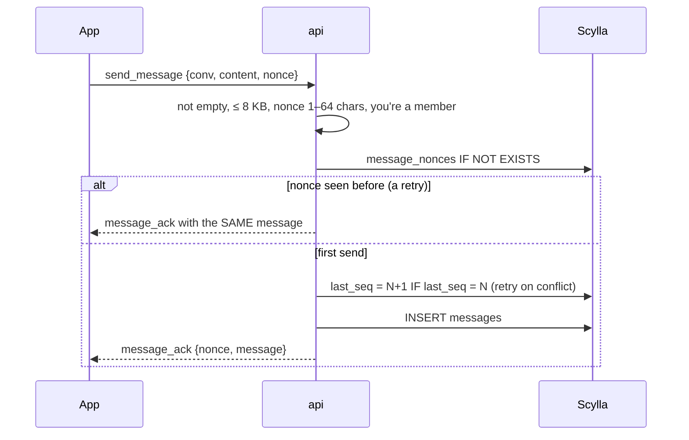
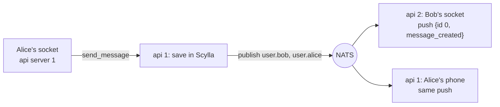

# DMs (MVP focus)

## Decided

- **DMs are stored on the hub**, so messages arrive even when the other person is offline.
- Content is stored as opaque `bytes`. MVP: plain text, protected by TLS + encrypted disk.
- **Who can DM you** is a user setting: everyone / friends of friends / friends only.
- **Group DMs: max 5 people.** Starting value, to be tuned after testing.
- **MVP: calls go through our SFU**, so they're encrypted to the server, not end-to-end. When P2P arrives, 1-on-1 calls become E2E by default (DTLS-SRTP).
- **Quality:** 60fps source for 1-on-1; groups start at 720p60 and scale up.

## How it works

Code: `services/api/src/features/{conversations,messages}`. Schema: `services/api/scylla/*.cql`.

### Storage (ScyllaDB)

Scylla has no joins and no `UNIQUE`, so there is **one table per question**:

| Table                   | Key                                   | Answers                              |
| ----------------------- | ------------------------------------- | ------------------------------------ |
| `conversations`         | `id`                                  | kind, members, `last_seq`            |
| `conversations_by_user` | `user_id` → conversation ids          | "my DM list"                         |
| `dm_keys`               | `"<small id>:<big id>"`               | "is there already a DM for A + B?"   |
| `messages`              | `(conversation_id, bucket)`, `id` ↓   | history, newest first                |
| `message_nonces`        | `(conversation_id, author_id, nonce)` | "did this client already send this?" |

- A **bucket** is ~10 days. One partition = one conversation's 10 days, so "latest 50" is one fast read and
  partitions never grow forever. History walks buckets backwards.
- User profiles stay in Postgres; conversations store only member ids.
- The keyspace has **tablets off**: in Scylla 2025 they don't support lightweight transactions, which we need.

### Lightweight transactions (LWT)

`INSERT … IF NOT EXISTS` / `UPDATE … IF x = y`: the Scylla replicas agree on **one winner**. The reply's
`[applied]` column says if our write went in (`lwt_applied()` in `common/scylla.rs`). Used for:

- **One DM per pair:** claim `dm_keys`. Lost? Read the winner's id. Then a LOGGED batch writes the
  conversation + one `conversations_by_user` row per member (all or nothing).
- **Nonces** and **seq** (below).

### Sending

**Nonce:** a random one-time id the **client** makes per message (`crypto.randomUUID()`). Two jobs:

1. **No duplicates on retry.** Wi-Fi drops after the server saved "hi" but before the ack arrived; the app
   resends with the same nonce and gets the same message back. Nonces are per sender and expire after a day.
2. **Match the ack to the bubble.** The app shows "hi" greyed out at once; the ack with that nonce turns it real.

**Three ids on a message:**

| Field   | Made by                  | Used for                                        |
| ------- | ------------------------ | ----------------------------------------------- |
| `nonce` | client                   | retries, matching the ack                       |
| `id`    | server (Snowflake)       | time order, paging (`before_id`)                |
| `seq`   | server, per conversation | "did I miss any?" (1, 2, 3…), sync on reconnect |

**seq** is a compare-and-set loop: "set `last_seq` to N+1 only if it's still N". Two senders at once: one wins,
the other retries and gets N+2. Known gap: a crash between taking a seq and saving the message skips that
number forever, so sync must tolerate holes.

### Live delivery (NATS)

- After auth, every socket subscribes to **`user.<its user id>`**.
- After saving, the server publishes the encoded `message_created` Envelope to `user.<id>` of **every member**.
  NATS delivers it to whichever api servers hold those sockets; they forward the bytes as is.
- Per-user subjects (not per conversation): a new DM needs no re-subscribing, and all your devices get it.
- The sender's own socket also gets the push; the app ignores it (it already has the ack, same `id`).
- If publishing fails, the message is still saved: the other person gets it from history / sync. Logged as a warning.
- Code: `common/events.rs` (`EventBus` trait + NATS), the `select!` loop in `gateway/connection.rs`.

### Rules

- Not a member, or no such conversation → the same `conversation_not_found` (don't reveal what exists).
- `content` is opaque bytes (max 8 KB); the server never reads it, so E2E can slot in later.

## Future plan: E2E for text (after the MVP)

Not in the MVP. Substantial future work (device credentials, membership changes, key lifecycle). These steps keep the door open:

1. Message content = opaque `bytes` in protobuf.
2. An `encryption` field on every message (`none` / `mls`).
3. Accounts have devices from day 1 (`device_id`).
4. Nothing on the server reads DM content. Search, link previews and filters run on the client.

When we do it:

- Protocol: **MLS** (RFC 9420) via `openmls` (MIT, pure Rust). Discord uses MLS for its own E2E voice/video.
  - 1-on-1 = a group of 2. Multi-device = each device is a member.
- The hub stores only encrypted blobs and **prekeys** (spare public keys, so you can start a chat with someone offline).
- Older messages stay marked "sent before E2E".
- To decide then: encrypted history backup (or lose history with all devices), and safety numbers / QR verification.

Why MLS over the Signal protocol: it handles groups and multi-device natively, it's an IETF standard, and `libsignal` is AGPL.

## Test plan: group size vs upload (when P2P arrives)

In P2P, the person sharing their screen uploads **one copy per viewer** (1080p60 ≈ 8 Mbps each, so 4 viewers ≈ 32 Mbps). Fine on fiber, tight on cable/DSL.

Simulate bad networks with a throttler and measure fps, resolution, latency and recovery with 2–5 people.

- Linux: `tc netem` · Windows: Clumsy · macOS: Network Link Conditioner

| Profile   | Down / Up              |
| --------- | ---------------------- |
| Fiber     | 500 / 500              |
| US cable  | 500 / 20               |
| DSL       | 50 / 10                |
| Bad Wi-Fi | + 2–5% packet loss     |
| 4G        | variable, high latency |

Possible fixes if needed: rely on WebRTC's automatic quality drop, encode once for all viewers, an optional relay for bigger groups.

## Open questions

- DM list order: by creation for now; should be by latest message.
