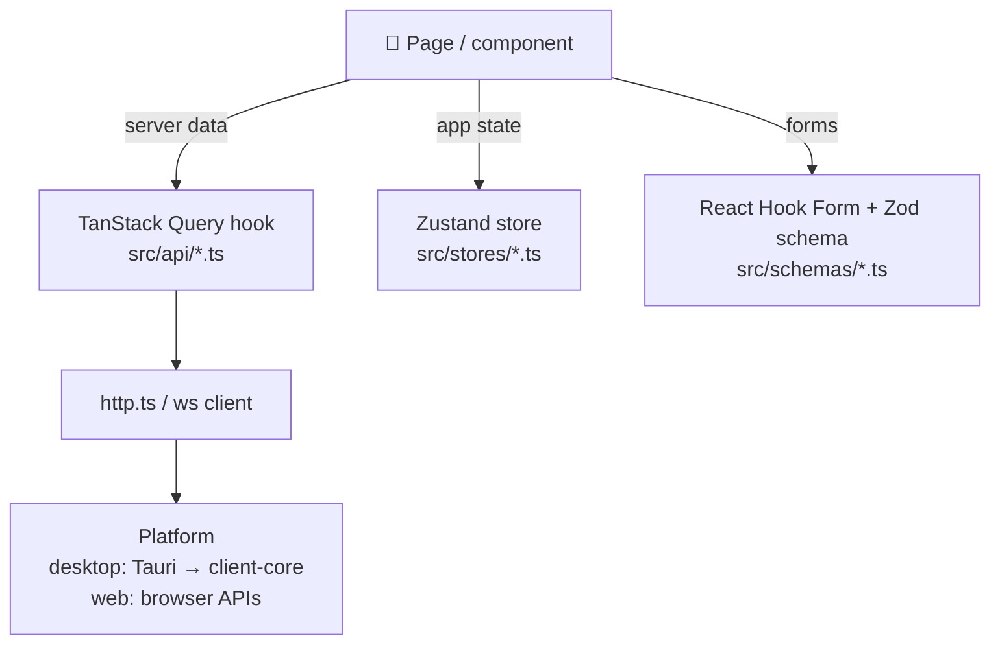
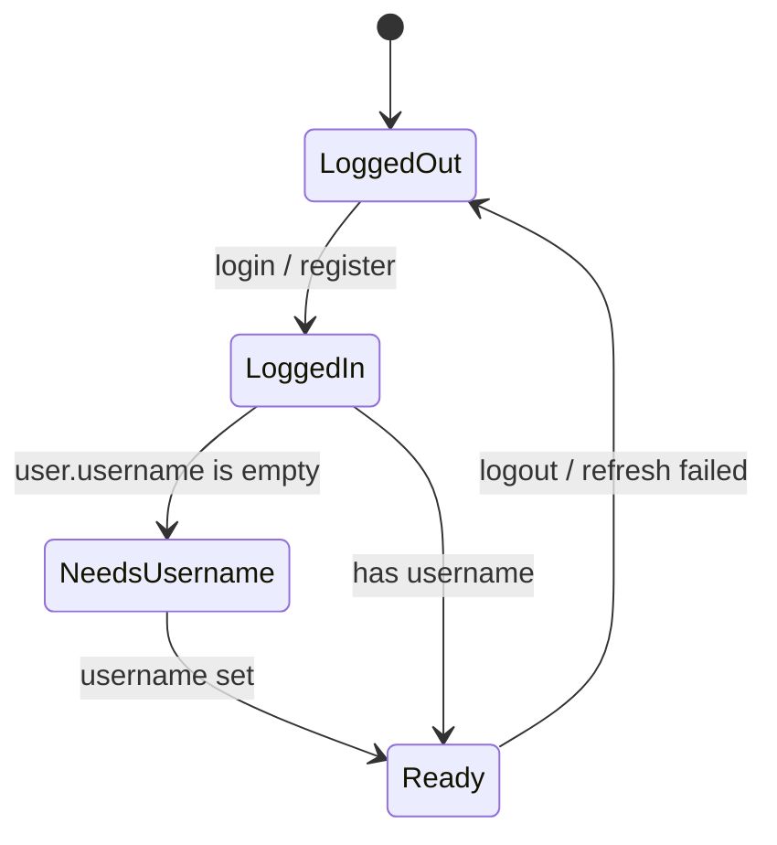

# Frontend

One React codebase for desktop (Tauri), web and, later, mobile.

## Stack

| Library                   | Job                                               |
| ------------------------- | ------------------------------------------------- |
| **React + TypeScript**    | UI                                                |
| **Vite**                  | Dev server and build                              |
| **Tailwind CSS v4**       | Styling (mandatory)                               |
| **TanStack Router**       | Pages, type-safe routes                           |
| **TanStack Query**        | Data from the API: caching, loading, errors       |
| **Zustand**               | Small app-wide state (auth status, current call)  |
| **React Hook Form + Zod** | Forms + validation before sending                 |
| `fetch` (small wrapper)   | HTTP calls. No Axios: the API is mostly WebSocket |
| `@bufbuild/protobuf`      | WebSocket messages (generated from `proto/`)      |

## Where does what go



**Rules for the team:**

1. Data from the API → a **TanStack Query** hook. Never `fetch` inside a component.
2. App-wide state → a **Zustand** store. Local UI state stays in `useState`.
3. Every form has a **Zod** schema. The same schema validates before sending.
4. Pages live in `src/routes/`. One file per page; the route tree is in `src/router.tsx`.
5. Styling is **Tailwind classes only**. No CSS files besides `index.css`.

## Folders

```text
client/src/
  routes/        pages (TanStack Router)
  components/    reusable UI pieces
  api/           Query hooks + http client
  stores/        Zustand stores
  schemas/       Zod schemas
  platform/      desktop vs web differences
  gen/           generated protobuf types (don't edit)
```

## Auth in the UI



The router sends you to the right page for each state: `/login`, `/username`, `/`.

- `src/api/http.ts` adds the token and **refreshes automatically** (before expiry, and once on a 401).
- If refresh fails, the auth store is cleared and the app goes back to `/login`.
- Tokens live in `localStorage` for now (`src/stores/auth.ts`). TODO: OS keychain on desktop.
