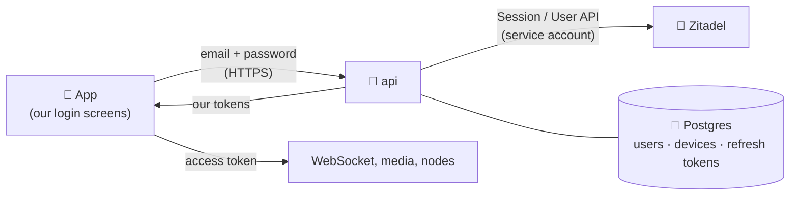
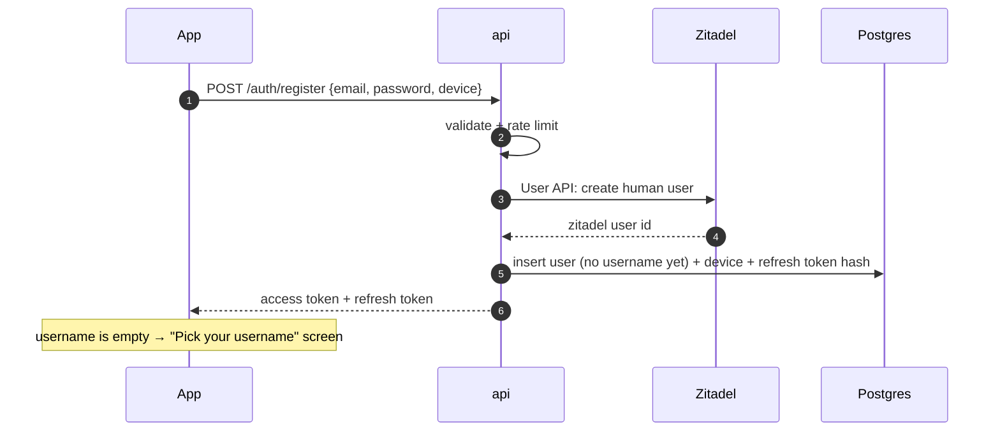
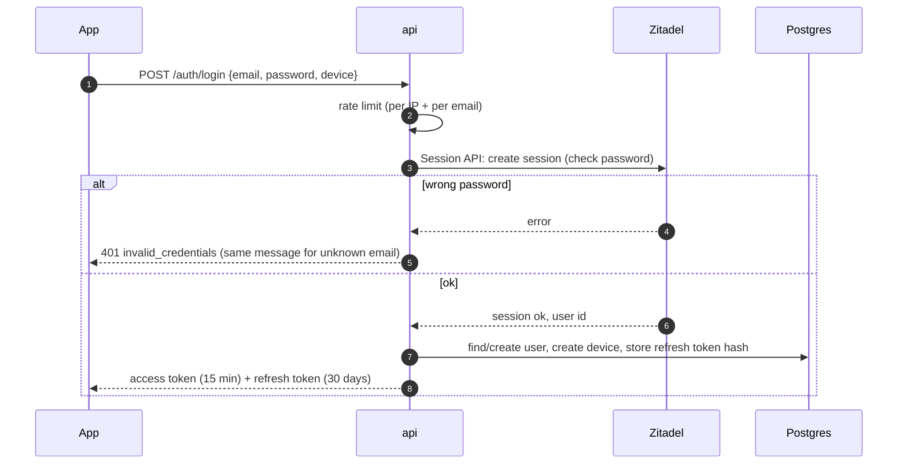
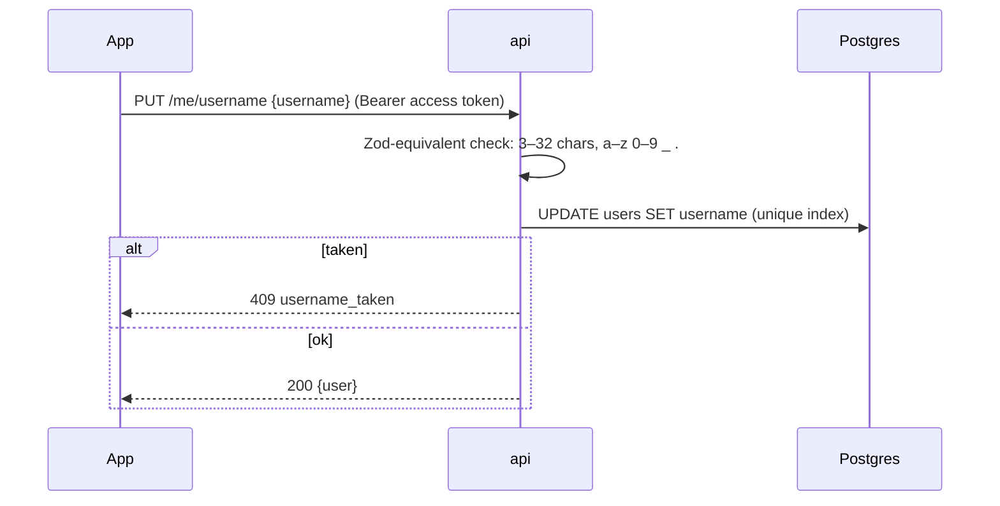
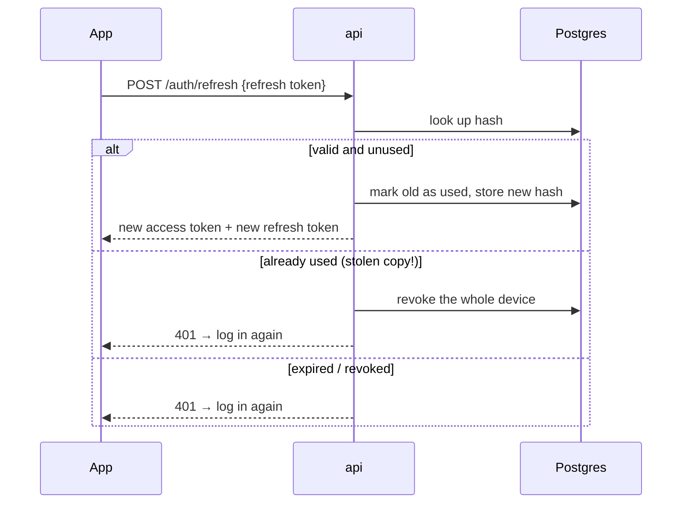
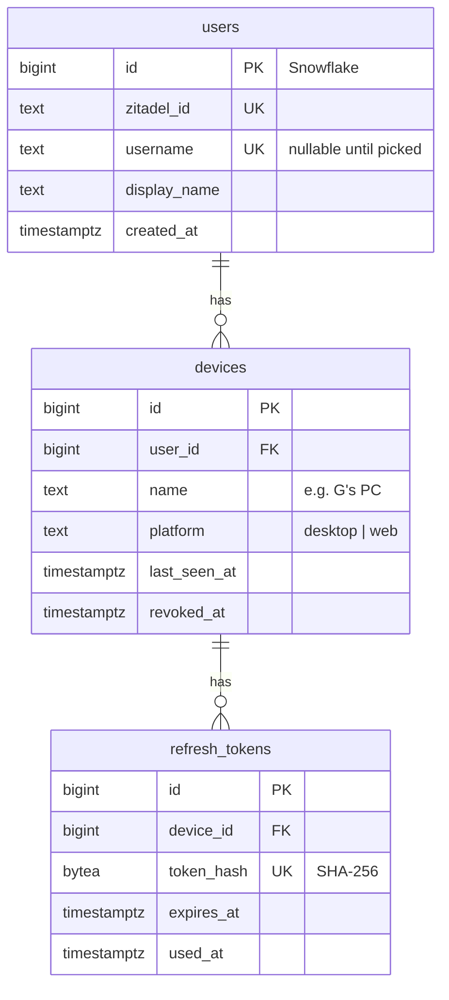

# Identity and auth

## Overview

- **Zitadel** (self-hosted) stores accounts and checks passwords.
- **Our `api`** is the only thing that talks to Zitadel. The app never does.
- After login, the api issues **our own tokens**. Everything else (WebSocket, media, nodes) only trusts our tokens.
- If we ever swap Zitadel, only the api's login code changes.



## Decided

| Topic         | Decision                                                                      |
| ------------- | ----------------------------------------------------------------------------- |
| Provider      | Zitadel, self-hosted                                                          |
| Login UI      | **Native screens in our app** (no browser redirect) via Zitadel's Session API |
| Day-1 methods | Email + password. Google/GitHub later (needs browser + deep link)             |
| Access token  | Ours, Ed25519-signed, **15 min**, verified without a DB lookup                |
| Refresh token | Ours, opaque, **30 days**, one per device, stored hashed, rotated on use      |
| Username      | Picked **after first login**, unique                                          |
| Token storage | Desktop: OS keychain. Web: memory + refresh token in an `HttpOnly` cookie     |

## Register



## Login



## Pick username (first login)



## Refresh (rotation + theft detection)



The app refreshes automatically shortly before the access token expires.

## Logout

`POST /auth/logout` revokes the current device and all its refresh tokens. Access tokens die on their own within 15 min.

## Endpoints (HTTP)

| Method | Path             | Auth          | Purpose                       |
| ------ | ---------------- | ------------- | ----------------------------- |
| POST   | `/auth/register` | —             | Create account + log in       |
| POST   | `/auth/login`    | —             | Email + password → our tokens |
| POST   | `/auth/refresh`  | refresh token | Rotate tokens                 |
| POST   | `/auth/logout`   | access token  | Revoke this device            |
| GET    | `/me`            | access token  | Current user                  |
| PUT    | `/me/username`   | access token  | Set username                  |

Errors use one shape: `{ "code": "username_taken", "message": "..." }`.

## Access token contents

```text
header:  { alg: EdDSA, kid: <key id> }
payload: { sub: user_id, did: device_id, iat, exp (+15 min), iss: "api" }
```

The `kid` lets us rotate signing keys: the api keeps old public keys until their tokens expire.

## Database



## Security rules

- **Never log passwords or tokens.** A test checks the logs.
- Same error for "unknown email" and "wrong password" (don't reveal who has an account).
- Rate limit login and register per IP and per email.
- Refresh tokens are stored as SHA-256 hashes only.
- HTTPS everywhere outside local dev.

## Local Zitadel setup

On a **fresh** database, Zitadel's first boot creates a service account for the api
(`api-service`, instance owner) and writes its token to `infra/.secrets/api.pat`
(git-ignored). The api reads it from there. No clicking in the console.

The api creates its token signing key at `infra/.secrets/api_signing_key` on first start.

To reset everything: `docker compose -f infra/docker-compose.yml down -v`, then `up -d --wait`.

## Testing

- Unit tests: `cargo test -p api` (tokens, validation, rate limit).
- End to end: `scripts/smoke-auth.sh` against a running api + stack (register, login, wrong password,
  forged token, username, refresh rotation, stolen-token reuse, logout).

## Hub ↔ node trust (after the MVP)

1. A node generates an **Ed25519** key pair and registers with the hub.
2. The user logs in to the hub.
3. The hub issues a **signed token** for that node: `(user_id, node_id, exp)`.
4. The node verifies it with the **hub's public key**, offline, with no call to the hub.
5. The node never sees the password.

## Later

- Google / GitHub login (system browser + PKCE + deep link back to the app).
- 2FA (TOTP) and passkeys: Zitadel supports both; we build the screens.
- Account deletion, email change, password reset.
- Revocation list for nodes.

## Risks

- Passwords pass through our api: logging mistakes would be serious (see the rules above).
- Building 2FA/passkey screens ourselves later is extra work vs Zitadel's hosted login.
