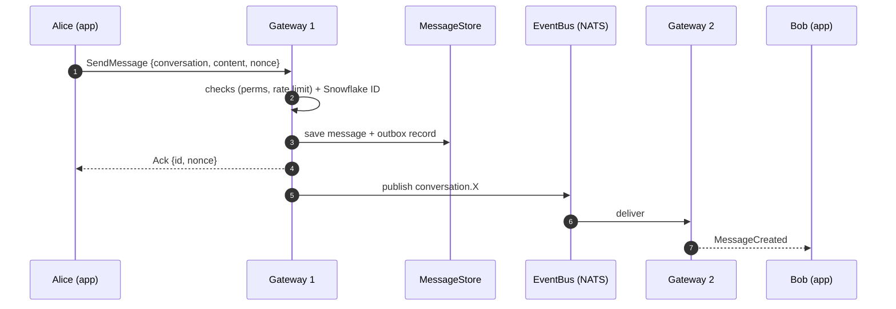

# Messaging

## Sending a message

1. **Connect (once):** the app opens the WebSocket and sends its token. The gateway remembers "this connection = user 42".
2. **Send:** `{ channel, content, nonce }`. The `nonce` is a client-made random ID used to match the ack and avoid duplicates.
3. **Checks:** permissions (cached in Redis), rate limit, validation.
4. **ID:** generate a **Snowflake** (time + machine + sequence, so IDs sort by time).
5. **Save** the message **and** a "to deliver" record together (outbox pattern). The `nonce` is unique per sender, so a resend can't duplicate.
6. **Ack** to the sender: "saved, ID 999, nonce abc". The grey "sending..." becomes real.
7. **Publish** to the event bus. A worker retries any undelivered outbox records.
8. Other gateways push it to their users.

**Save before publish**, and the outbox makes sure a crash between save and publish can't lose a message.

## Storage and fan-out are traits

- `MessageStore`: where messages live.
- `EventBus`: how events reach every gateway.
- Same API, different backends per profile.

## Node profiles

| Profile    | For                      | MessageStore | EventBus  | Gateways                  |
| ---------- | ------------------------ | ------------ | --------- | ------------------------- |
| **Small**  | "My PC", friends (≤ ~50) | SQLite       | In memory | 1                         |
| **Medium** | Self-host (≤ ~5k)        | Postgres     | In memory | 1                         |
| **Big**    | Us / large communities   | ScyllaDB     | NATS      | 2+ behind a load balancer |

- The app **recommends a profile** based on expected users.
- A **migration tool** moves a node up a profile (SQLite → Postgres → Scylla).
- Our hosted infra is always Big, and multi-tenant.
- Limits are guesses until benchmarked.
- **The hub (DMs) runs ScyllaDB + NATS from day 1**: it holds everyone's DMs, so it grows first. Users/friends/settings stay in Postgres.

## The pieces

- **ScyllaDB:** a database built for huge write volumes (a C++ rewrite of Cassandra; Discord uses it). Partition key `(channel_id, bucket ~10 days)`, so "last 50 messages" is one fast read. Heavy to run.
- **NATS (Core):** tiny, fast pub/sub. Core NATS stores nothing (JetStream, the optional add-on, does). Only needed with 2+ gateways, so a message on gateway 1 reaches users on gateway 3. (Redis pub/sub is an alternative.)

## Order, unread, retries

The DM list is sorted by the last message, each user has a private unread count, and
group/friend actions are safe to retry. Details: [dms.md](dms.md#list-order-and-unread).

## Open questions

- Message events: reactions, threads, pins. (Edit + delete: done for DMs, see [dms.md](dms.md#edit-and-delete).)
- Full-text search: Tantivy? Meilisearch? (For DMs it must run client-side, see [dms.md](dms.md).)
- Migration between profiles without downtime.
- NATS or Redis pub/sub for Big.

## Risks

- Three backends = more testing. One shared test suite every backend must pass.
- Very busy channels create hot partitions in Scylla (time buckets help).
- Quiet conversations with 10-day buckets need several reads for "last 50". Fix when designing the schema (track the latest bucket, or bucket by count).
