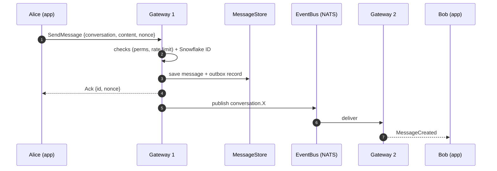

# Messaging

## Sending a message

1. **Connect (once):** the app opens the WebSocket and sends its token. The gateway remembers "this connection = user 42".
2. **Send:** `{ channel, content, nonce }`. The `nonce` is a client-made random ID used to match the ack and avoid duplicates.
3. **Checks:** permissions (cached in Redis), rate limit, validation.
4. **ID:** generate a **Snowflake** (time + machine + sequence, so IDs sort by time).
5. **Save** the message **and** a "to deliver" record together (outbox pattern). The `nonce` is unique per sender, so a resend can't duplicate.
6. **Ack** to the sender: "saved, ID 999, nonce abc". The grey "sending..." becomes real.
7. **Publish** to the event bus. A worker retries any undelivered outbox records.
8. Other gateways push it to their users.

**Save before publish**, and the outbox makes sure a crash between save and publish can't lose a message.

## Replies

DMs and group DMs can reply to a message.

- `SendMessage.reply_to` holds the original's id. `0` means it isn't a reply.
- The API checks that the original exists in **the same conversation**. If it doesn't, the send fails with `bad_reply`.
- `Message.reply_to` is stored on the row (Scylla `messages.reply_to`, see `007_message_replies.cql`). It's returned in history, sync, the ack and `MessageCreated`.
- Only the id is stored, not a copy of the text. The client looks the original up in what it has loaded.
- **Deleted originals:** the reply keeps its `reply_to`. The client shows "Original deleted" when it saw the delete or can't find the message in history.
- **Not loaded yet:** clicking the quote pages back through history (up to 20 pages), then scrolls to the message.
- Replies don't notify the original's author (yet).

## Storage and fan-out are traits

- `MessageStore`: where messages live.
- `EventBus`: how events reach every gateway.
- Same API, different backends per profile.

## Node profiles

| Profile    | For                      | MessageStore | EventBus  | Gateways                  |
| ---------- | ------------------------ | ------------ | --------- | ------------------------- |
| **Small**  | "My PC", friends (≤ ~50) | SQLite       | In memory | 1                         |
| **Medium** | Self-host (≤ ~5k)        | Postgres     | In memory | 1                         |
| **Big**    | Us / large communities   | ScyllaDB     | NATS      | 2+ behind a load balancer |

- The app **recommends a profile** based on expected users.
- A **migration tool** moves a node up a profile (SQLite → Postgres → Scylla).
- Our hosted infra is always Big, and multi-tenant.
- Limits are guesses until benchmarked.
- **The hub (DMs) runs ScyllaDB + NATS from day 1**: it holds everyone's DMs, so it grows first. Users/friends/settings stay in Postgres.

## The pieces

- **ScyllaDB:** a database built for huge write volumes (a C++ rewrite of Cassandra; Discord uses it). Partition key `(channel_id, bucket ~10 days)`, so "last 50 messages" is one fast read. Heavy to run.
- **NATS (Core):** tiny, fast pub/sub. Core NATS stores nothing (JetStream, the optional add-on, does). Only needed with 2+ gateways, so a message on gateway 1 reaches users on gateway 3. (Redis pub/sub is an alternative.)

## Reactions

Emoji reactions on messages in DMs and group DMs. Done for the hub.

- **Requests:** `AddReaction`, `RemoveReaction` → `ReactionAck` (the message's reactions now + a `seq`). `GetReactors` → `Reactors` (up to 100 user ids, for the "who reacted" tooltip).
- **Push:** `ReactionUpdated` to every member, the sender too: emoji, user, added/removed, new `count` (absolute, so applying it twice is safe).
- **On `Message`:** `reactions` = emoji, count, `me` (did I react). Filled per viewer in History and Sync. Empty in `MessageCreated`/`MessageUpdated` pushes: clients keep what they have.
- **Storage:** Scylla `message_reactions`, partition `(conversation_id, message_id)`, rows `(emoji, user_id)`. Add/remove use LWT (`IF NOT EXISTS` / `IF EXISTS`), so a repeat is a no-op (`seq = 0`, no push). Deleting a message deletes its reactions.
- **Sync:** each real change takes a conversation seq and a `message_changes` row (kind 3). Sync returns the message in `edited`, with its current reactions.
- **Limits:** any member can react. Unicode emoji only (max 32 bytes, no letters/digits/spaces). Max 20 different emojis per message (`too_many_reactions`); adding to one already there always works. Max 10 changes per 10s per user (`rate_limited`), kept in memory per API node.
- **Not yet:** custom emoji. Read receipts are a separate thing and are never shown.

## Open questions

- Message events: threads, pins. (Edit + delete: done for DMs, see [dms.md](dms.md#edit-and-delete). Reactions: see above.)
- Full-text search: Tantivy? Meilisearch? (For DMs it must run client-side, see [dms.md](dms.md).)
- Migration between profiles without downtime.
- NATS or Redis pub/sub for Big.

## Risks

- Three backends = more testing. One shared test suite every backend must pass.
- Very busy channels create hot partitions in Scylla (time buckets help).
- Quiet conversations with 10-day buckets need several reads for "last 50". Fix when designing the schema (track the latest bucket, or bucket by count).

## Markdown in messages

The web and desktop clients render Markdown in direct and group messages.
The composer and edit field use the original text. The protocol and storage
still carry plain text, so clients can render Markdown after decryption when
end-to-end encryption is added.

The renderer supports bold, italic, strikethrough, inline code, fenced code,
quotes, ordered and unordered lists, spoilers, and HTTP(S) links. HTML tags
and Markdown images display as text. Links open in a new tab with
`noreferrer noopener`. Rendering does not fetch external resources or previews.

Fenced code blocks have a copy button. The client loads syntax highlighting
on demand for fences with a language label. Unknown languages display as plain
code.
