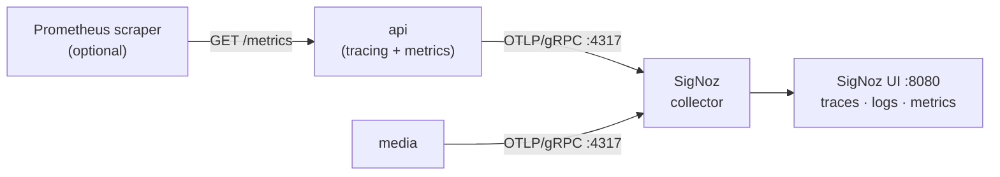

# Observability

Logs, traces and metrics from every Rust service. Locally they go to
**SigNoz** (runs outside this repo). Off by default: with no
`OTEL_EXPORTER_OTLP_ENDPOINT`, services only log to stdout.

## How it flows



Setup lives in `libs/common/src/telemetry.rs`:

- **Logs:** every `tracing` event, with its fields, linked to the current trace.
- **Traces:** every `tracing` span. Each HTTP request is one span named
  `METHOD /route` with `http.request.method`, `http.route`,
  `http.response.status_code` (duration = span length).
- **Metrics:** the `metrics` crate feeds two places: the Prometheus `/metrics`
  endpoint (always) and OTLP (when enabled).
- **Resource:** `service.name` (`api`, `media`; override with `OTEL_SERVICE_NAME`), `service.version`,
  `deployment.environment` (from `APP_ENV`).
- Exporters flush on shutdown (Ctrl+C / SIGTERM).

## Turn it on

```sh
OTEL_EXPORTER_OTLP_ENDPOINT=http://127.0.0.1:4317 cargo run -p api
```

Then open http://127.0.0.1:8080 → **Services → api** (traces),
**Logs** (filter `service.name = api`), **Metrics** / dashboards.

## What is measured (api)

| Metric                                 | Type      | Labels                                                             |
| -------------------------------------- | --------- | ------------------------------------------------------------------ |
| `http_server_requests_total`           | counter   | `method`, `route`, `status`                                        |
| `http_server_request_duration_seconds` | histogram | `method`, `route`, `status`                                        |
| `auth_logins_total`                    | counter   | `result`: ok, failed, error                                        |
| `auth_registrations_total`             | counter   | `result`: ok, rejected, error                                      |
| `auth_refreshes_total`                 | counter   | `result`: ok, superseded, reused, revoked, expired, invalid, error |
| `rate_limited_requests_total`          | counter   | `rule` (e.g. `login:ip`)                                           |
| `ws_connections`                       | gauge     | —                                                                  |
| `ws_requests_total`                    | counter   | —                                                                  |

`reused` = an old refresh token came back late: likely theft, device revoked.
`superseded` = two tabs refreshed at once: harmless.

## Naming rules

- `snake_case`, Prometheus style: `<area>_<thing>_<unit>`; counters end in `_total`.
- Durations in **seconds** (`_seconds`).
- Labels are **small fixed sets**. `route` is the template (`/me/username`),
  never the raw path. Unknown paths → `unmatched`.
- Never user ids, emails, IPs or device ids as labels. Put them in logs if needed.
- Auth metrics live in `features/auth/metrics.rs` and are recorded in the
  **service**, not the controller.

## No secrets, ever

Nothing exported may contain passwords, tokens, or the `Authorization` header.

- The HTTP span records method, route and status only. No headers, no bodies, no query strings.
- Request types holding secrets implement `Debug` as `<redacted>`.
- Never `tracing::info!(?req)` on a request that holds a password or token.
- Checked after changes: run `scripts/smoke-auth.sh` with OTLP on and search
  SigNoz for the smoke password and tokens. They must not appear.

## Open questions

- [ ] Production backend (SigNoz self-hosted vs Grafana stack)
- [ ] Sampling once traffic grows (now: every trace)
