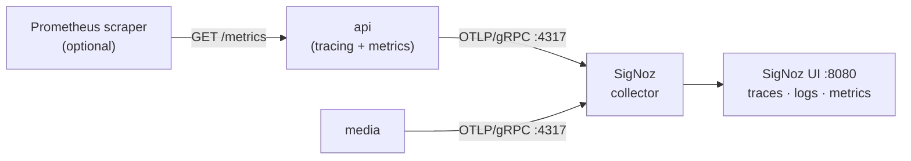

# Observability

Logs, traces and metrics from every Rust service. Locally they go to
**SigNoz** (runs outside this repo). Off by default: with no
`OTEL_EXPORTER_OTLP_ENDPOINT`, services only log to stdout.

## How it flows



Setup lives in `libs/common/src/telemetry.rs`:

- **Logs:** every `tracing` event, with its fields, linked to the current trace.
- **Traces:** every `tracing` span. Each HTTP request is one span named
  `METHOD /route` with `http.request.method`, `http.route`,
  `http.response.status_code` (duration = span length).
- **Span tree** (e.g. a login):
  `POST /auth/login` → `auth.login` → `zitadel verify_password`, `db SELECT users`,
  `db INSERT devices`, `db INSERT refresh_tokens`.
  - Request span: `error.code` (e.g. `invalid_credentials`), `user.id`, `device.id`.
  - Service spans: `outcome` (same values as the metrics), `user.id`, `device.id`.
  - DB spans: `db.system`, `db.operation`, `db.collection.name`. Zitadel spans: `zitadel.status`, `outcome`.
  - All spans use `skip_all`: function arguments (passwords, tokens) are never recorded.
- **Metrics:** the `metrics` crate feeds two places: the Prometheus `/metrics`
  endpoint (always) and OTLP (when enabled).
- **Resource:** `service.name` (`api`, `media`; override with `OTEL_SERVICE_NAME`), `service.version`,
  `deployment.environment` (from `APP_ENV`).
- Exporters flush on shutdown (Ctrl+C / SIGTERM).

## Turn it on

```sh
OTEL_EXPORTER_OTLP_ENDPOINT=http://127.0.0.1:4317 cargo run -p api
```

Then open http://127.0.0.1:8080 → **Services → api** (traces),
**Logs** (filter `service.name = api`), **Metrics** / dashboards.

### Settings (env vars, or `.env`)

| Variable                      | Default         | What it does                                         |
| ----------------------------- | --------------- | ---------------------------------------------------- |
| `OTEL_EXPORTER_OTLP_ENDPOINT` | unset (off)     | Where to send. Local SigNoz: `http://127.0.0.1:4317` |
| `OTEL_SERVICE_NAME`           | `api` / `media` | Name in SigNoz. Handy to tell test runs apart        |
| `OTEL_METRIC_EXPORT_INTERVAL` | `60000` (ms)    | How often metrics are sent. `5000` while testing     |
| `APP_ENV`                     | `development`   | Becomes `deployment.environment`                     |
| `RUST_LOG`                    | `info`          | Log level. Also limits what is exported              |
| `LOG_FORMAT`                  | text            | `json` for structured stdout                         |

## How to use it (in code)

Everything goes through the normal `tracing` and `metrics` crates. You never
call OpenTelemetry directly.

### 1. Logs

```rust
tracing::info!(user.id = user.id, "username changed");
tracing::warn!(device_id, "refresh token reuse, device revoked");
```

- Fields become log attributes in SigNoz, and the log links to the current trace.
- Use fields, not `format!` in the message: fields can be filtered.
- `RUST_LOG` decides what is sent. `debug!` logs don't reach SigNoz at the default `info`.

### 2. Spans (steps in a trace)

Add `#[tracing::instrument]` to a function. It becomes a child of whatever
span is active (usually the HTTP request).

```rust
// Service method: name it <feature>.<action>
#[tracing::instrument(name = "users.set_username", skip_all, fields(user.id = id))]
pub async fn set_username(&self, id: i64, raw: &str) -> Result<User, ApiError> { … }

// Repository method: name it "db <OPERATION> <table>"
#[tracing::instrument(name = "db SELECT users", skip_all, err(Display),
    fields(otel.kind = "client", db.system = "postgresql",
           db.operation = "SELECT", db.collection.name = "users"))]
async fn find_by_id(&self, id: i64) -> Result<Option<User>, RepoError> { … }
```

Rules:

- **Always `skip_all`.** Without it, every argument (passwords, tokens) is recorded.
- Add fields by hand, only safe ones: internal ids, fixed codes, counts.
- With `async_trait`, put `#[instrument]` on the **impl** method, not the trait.
- Use `err(Display)` only when the error text can't contain user input.

**Fill a field later**: declare it empty, then record it once you know it.

```rust
#[tracing::instrument(name = "auth.login", skip_all,
    fields(user.id = tracing::field::Empty, outcome = tracing::field::Empty))]
async fn login(…) {
    …
    tracing::Span::current().record("user.id", user.id);
}
```

Recording a field that wasn't declared does nothing (no error), so declare it first.

**Free on every request** (no code needed): the request span has
`http.route`, `http.request.method`, `http.response.status_code`, plus:

- `error.code`: set automatically when a handler returns an `ApiError`.
- `user.id`, `device.id`: set automatically when the handler uses `AuthUser`.

### 3. Metrics

Each feature keeps its metrics in `features/<name>/metrics.rs`
(see `features/auth/metrics.rs`) and calls them from the **service**:

```rust
// features/friends/metrics.rs
pub const REQUESTS: &str = "friends_requests_total";

/// `result`: `sent`, `blocked`, `error`.
pub fn request(result: &'static str) {
    metrics::counter!(REQUESTS, "result" => result).increment(1);
}
```

- Counter: `metrics::counter!(name, labels).increment(1)`.
- Histogram: `metrics::histogram!(name, labels).record(seconds)`. For a new
  histogram, add buckets in `main.rs` (`set_buckets_for_metric`), or
  `/metrics` shows it as a summary.
- Gauge: `metrics::gauge!(name).increment(1.0)` / `.decrement(1.0)`.
- The same call shows up in both `/metrics` and SigNoz.
- Follow the [naming rules](#naming-rules). Add the metric to the table above.

### 4. A new service

```rust
#[tokio::main]
async fn main() -> anyhow::Result<()> {
    let _ = dotenvy::dotenv(); // before telemetry, so .env settings apply
    let mut telemetry = common::telemetry::init("friends", env!("CARGO_PKG_VERSION"));
    telemetry.install_metrics(PrometheusBuilder::new().build_recorder())?; // if it has metrics
    // … run until shutdown …
    telemetry.shutdown(); // flushes; also happens on drop
    Ok(())
}
```

Keep `telemetry` alive for the whole program. `let _ = init(…)` drops it at once
and stops exporting.

### 5. Check your change

1. Run with `OTEL_EXPORTER_OTLP_ENDPOINT=http://127.0.0.1:4317 OTEL_METRIC_EXPORT_INTERVAL=5000`.
2. Hit the endpoint (or `scripts/smoke-auth.sh`).
3. SigNoz → **Traces** → filter your service → open a trace: your span is in the tree.
4. Metrics without SigNoz: `curl -s 127.0.0.1:7100/metrics | grep <name>`.
5. Search SigNoz logs and traces for any password or token you used. Zero hits.

## What is measured (api)

| Metric                                 | Type      | Labels                                                             |
| -------------------------------------- | --------- | ------------------------------------------------------------------ |
| `http_server_requests_total`           | counter   | `method`, `route`, `status`                                        |
| `http_server_request_duration_seconds` | histogram | `method`, `route`, `status`                                        |
| `auth_logins_total`                    | counter   | `result`: ok, failed, error                                        |
| `auth_registrations_total`             | counter   | `result`: ok, rejected, error                                      |
| `auth_refreshes_total`                 | counter   | `result`: ok, superseded, reused, revoked, expired, invalid, error |
| `rate_limited_requests_total`          | counter   | `rule` (e.g. `login:ip`)                                           |
| `ws_connections`                       | gauge     | —                                                                  |
| `ws_requests_total`                    | counter   | —                                                                  |

`reused` = an old refresh token came back late: likely theft, device revoked.
`superseded` = two tabs refreshed at once: harmless.

## Naming rules

- `snake_case`, Prometheus style: `<area>_<thing>_<unit>`; counters end in `_total`.
- Durations in **seconds** (`_seconds`).
- Labels are **small fixed sets**. `route` is the template (`/me/username`),
  never the raw path. Unknown paths → `unmatched`.
- Never user ids, emails, IPs or device ids as labels. Put them in logs if needed.
- Auth metrics live in `features/auth/metrics.rs` and are recorded in the
  **service**, not the controller.

## No secrets, ever

Nothing exported may contain passwords, tokens, or the `Authorization` header.

- Spans record method, route, status, error code and internal ids only. No headers, bodies, query strings, emails or error messages from Zitadel (they can echo input).
- New `#[tracing::instrument]` must use `skip_all` and add fields explicitly.
- Request types holding secrets implement `Debug` as `<redacted>`.
- Never `tracing::info!(?req)` on a request that holds a password or token.
- Checked after changes: run `scripts/smoke-auth.sh` with OTLP on and search
  SigNoz for the smoke password and tokens. They must not appear.

## Open questions

- [ ] Production backend (SigNoz self-hosted vs Grafana stack)
- [ ] Sampling once traffic grows (now: every trace)
