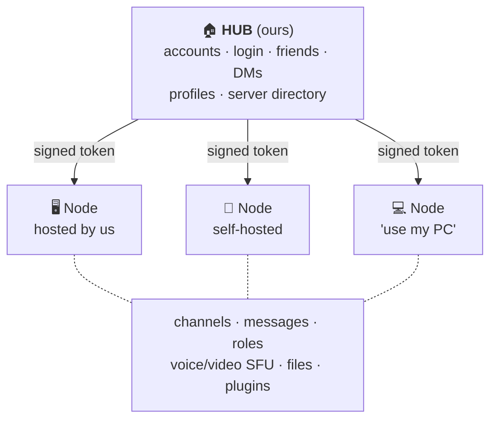

# Architecture overview

## Hub + nodes

- **Hub** says WHO you are.
- **Node** decides WHAT you can do on that server.

The MVP only builds the hub (DMs). Nodes come after.

## The hub

Run by us. Owns everything that isn't tied to a single server:
accounts, friends, DMs, profiles/cosmetics, the public directory, each user's server list.

## Nodes (servers)

A node is one community server. Three ways to run one:

1. **Hosted by us:** free or premium. Creating one is one click.
2. **Self-hosted:** Docker, or a single Rust binary + `node.toml`.
3. **"Use my PC":** a node embedded in the Tauri app, with a tunnel/relay for NAT.

Same binary, different **profiles** (Small / Medium / Big). See [messaging.md](messaging.md).

Our hosted nodes share one big **multi-tenant** cluster (many servers in the same database, separated by `server_id`). Never one database per server.

## Failure modes

| Problem          | Answer                                            |
| ---------------- | ------------------------------------------------- |
| Node offline     | DMs keep working (they live on the hub)           |
| Malicious node   | Can't fake identities; can only read its own chat |
| Illegal content  | Removed from the directory / blocked at the hub   |
| NAT              | Optional tunnel                                   |
| Hub down         | Tokens stay valid until they expire               |
| Version mismatch | Versioned protocol                                |
