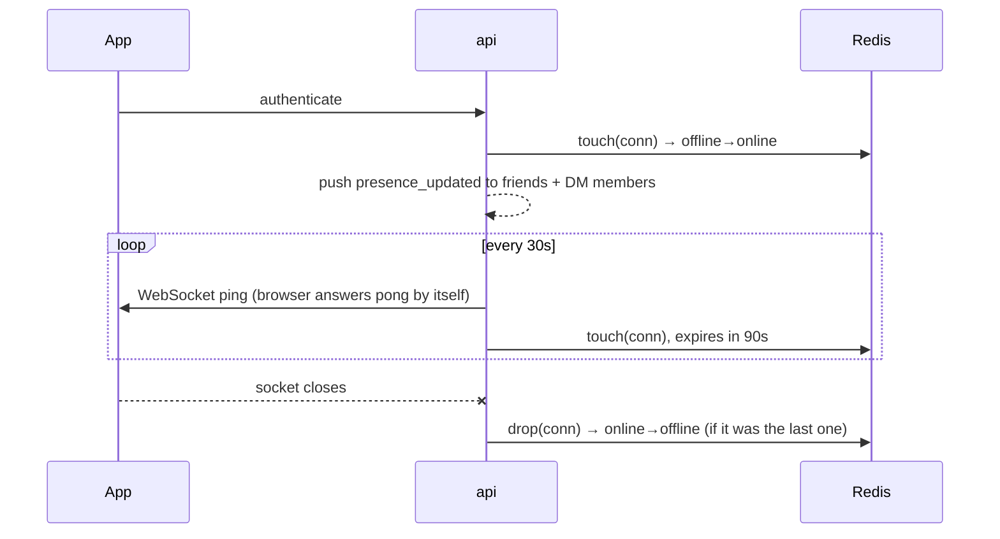

# Presence

Who is online. Three states: **online**, **idle**, **offline**.

## Rules

| State   | When                                             |
| ------- | ------------------------------------------------ |
| online  | at least one open socket that isn't idle         |
| idle    | every open socket is idle                        |
| offline | no open socket (or none sent a heartbeat lately) |

- Multi-device: each socket counts on its own. Closing your phone keeps you online on desktop.
- **Who can see it:** accepted friends, and members of your DMs and groups. Nobody else.
  A pending friend request doesn't count.
- The client marks a socket idle after **5 min without input**, or while the window is hidden.

## Storage (Redis)

One hash per user, `presence:<user_id>`: `connection_id → "<expires_at_ms>:<idle 0|1>"`.

- Every change runs as **one Lua script**: drop expired sockets, apply the change,
  return the status before and after. Atomic, so two devices connecting at once
  send exactly one "online" push.
- The hash expires on its own once every socket is gone.
- `PresenceStore` trait: `RedisPresenceStore` in real use, `MemoryPresenceStore` in tests.
- Config: `REDIS_URL` (default `redis://127.0.0.1:6379`).

## Heartbeat

- Nothing heard from the client for **75s** → the server closes the socket.
- An api server that **crashes** can't say goodbye. Its sockets stop being refreshed
  and count as offline after **90s** (the TTL).
  Known gap: no push for that case. Clients see it on their next `get_presence` (reconnect).

## Protocol

| Client sends              | Reply       | Notes                                      |
| ------------------------- | ----------- | ------------------------------------------ |
| `set_idle {idle}`         | `pong`      | this socket only                           |
| `get_presence {user_ids}` | `presences` | users you can't see are left out; max 200  |
| — (push, id 0)            | `presence_updated {user_id, status}` | to friends, DM members, and your other devices |

- Pushes go only on a real change (online → idle, …), through NATS `user.<id>`.
- The client calls `get_presence` (in pages of 200) with its friends + DM members after every
  (re)connect, and again when those lists change (new friend, new DM).
- A new friend or DM doesn't push presence: the client's reload covers it.

## Test

- Unit: `cargo test -p api presence` (service with in-memory fakes).
- Redis script: `cargo test -p api presence -- --ignored` (needs Redis running).
- End to end: `API_HTTP=http://127.0.0.1:7100 pnpm --filter mock smoke:presence` (registers 3 users).
- UI: `pnpm --filter mock start`: user 2 flips online/idle every 20s.
