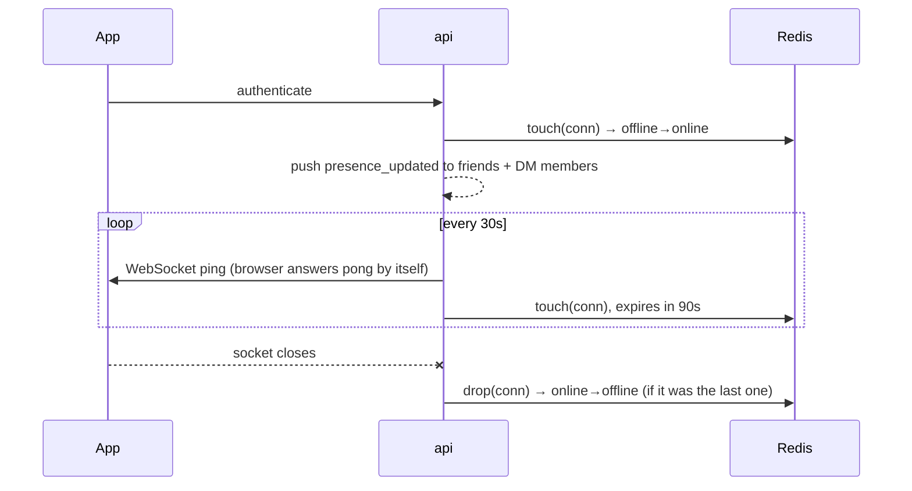

# Presence

Who is online. Three states: **online**, **idle**, **offline**.

## Rules

| State   | When                                             |
| ------- | ------------------------------------------------ |
| online  | at least one open socket that isn't idle         |
| idle    | every open socket is idle                        |
| offline | no open socket (or none sent a heartbeat lately) |

- Multi-device: each socket counts on its own. Closing your phone keeps you online on desktop.
- **Who can see it:** accepted friends, and members of your DMs and groups. Nobody else.
  A pending friend request doesn't count.
- The client marks a socket idle after **5 min without input**, or while the window is hidden.

## Storage (Redis)

One hash per user, `presence:<user_id>`: `connection_id → "<expires_at_ms>:<idle 0|1>"`.

- Every change runs as **one Lua script**: drop expired sockets, apply the change,
  return the status before and after. Atomic, so two devices connecting at once
  send exactly one "online" push.
- The hash expires on its own once every socket is gone.
- `PresenceStore` trait: `RedisPresenceStore` in real use, `MemoryPresenceStore` in tests.
- Config: `REDIS_URL` (default `redis://127.0.0.1:6379`).

## Heartbeat

- Nothing heard from the client for **75s** → the server closes the socket.
- An api server that **crashes** can't say goodbye. Its sockets stop being refreshed
  and count as offline after **90s** (the TTL).
  Known gap: no push for that case. Clients see it on their next `get_presence` (reconnect).

## Protocol

| Client sends              | Reply       | Notes                                      |
| ------------------------- | ----------- | ------------------------------------------ |
| `set_idle {idle}`         | `pong`      | this socket only                           |
| `get_presence {user_ids}` | `presences` | users you can't see are left out; max 200  |
| — (push, id 0)            | `presence_updated {user_id, status}` | to friends, DM members, and your other devices |

- Pushes go only on a real change (online → idle, …), through NATS `user.<id>`.
- The client calls `get_presence` (in pages of 200) with its friends + DM members after every
  (re)connect, and again when those lists change (new friend, new DM).
- A new friend or DM doesn't push presence: the client's reload covers it.

## Test

- Unit: `cargo test -p api presence` (service with in-memory fakes).
- Redis script: `cargo test -p api presence -- --ignored` (needs Redis running).
- End to end: `API_HTTP=http://127.0.0.1:7100 pnpm --filter mock smoke:presence` (registers 3 users).
- UI: `pnpm --filter mock start`: user 2 flips online/idle every 20s.

## Gaming activity

Activity is separate from online status. It is off by default on every new
connection. Users enter a game or stream label and choose **Share activity**.
The API accepts up to 100 UTF-8 bytes without control characters.

`SetActivity {label}` stores the label for the authenticated connection. An empty
label clears it. Redis stores labels in `activity:<user_id>`, keyed by connection.
The presence Lua script removes labels with expired or closed connections and
refreshes the activity hash TTL alongside presence. Reads also filter expired
connections, so a crashed API cannot leave visible activity behind.

`GetActivities {user_ids}` accepts at most 200 IDs. The server returns activity
only for accepted friends, even when the caller shares a DM or group with someone
else. It derives Streaming from that connection's active call screen-share state;
clients cannot claim Streaming with an activity label. A streaming connection wins
when several devices publish activity; otherwise the highest connection ID wins.
Connection IDs are random, so this is stable rather than a recency preference.

The client refreshes activity every 10 seconds, replaces the previous results,
and clears its cache on disconnect or friendship-list changes. A stalled refresh
clears cached activity 20 seconds after the last successful read. Friendship
revocation takes effect on the next server read, with no further activity sent to
the former friend. Previously delivered information cannot be withdrawn.

`JoinFriendCall {friend_id, sdp_offer}` resolves the friend's current call on the
server. Accepted friendship, actual friend participation, and current conversation
membership are required. Admission rechecks access after media setup and removes
the joining connection if it lost access. The response uses the existing
`CallJoined` message. Activity reads expose only whether joining is allowed, not
private call IDs or membership lists.

This release supports **Join call** in existing DM/group calls. Server voice
rooms and View/Connect permissions remain a separate prerequisite for server
voice channels. The existing media path and its group-call limitations apply.
Call discovery and Streaming use the existing process-local call state, so they
have the same single-API-instance limitation as calls today.

Automatic game detection is not implemented on any platform. Browser clients
cannot enumerate running games. Windows, macOS, and Linux desktop clients use
manual labels too; native detection needs a separate opt-in adapter and validation
on each OS. Screen capture still uses the platform/browser picker and never
publishes its raw window title. A label remains Playing after screen sharing ends
until the user clears it or its connection closes.
