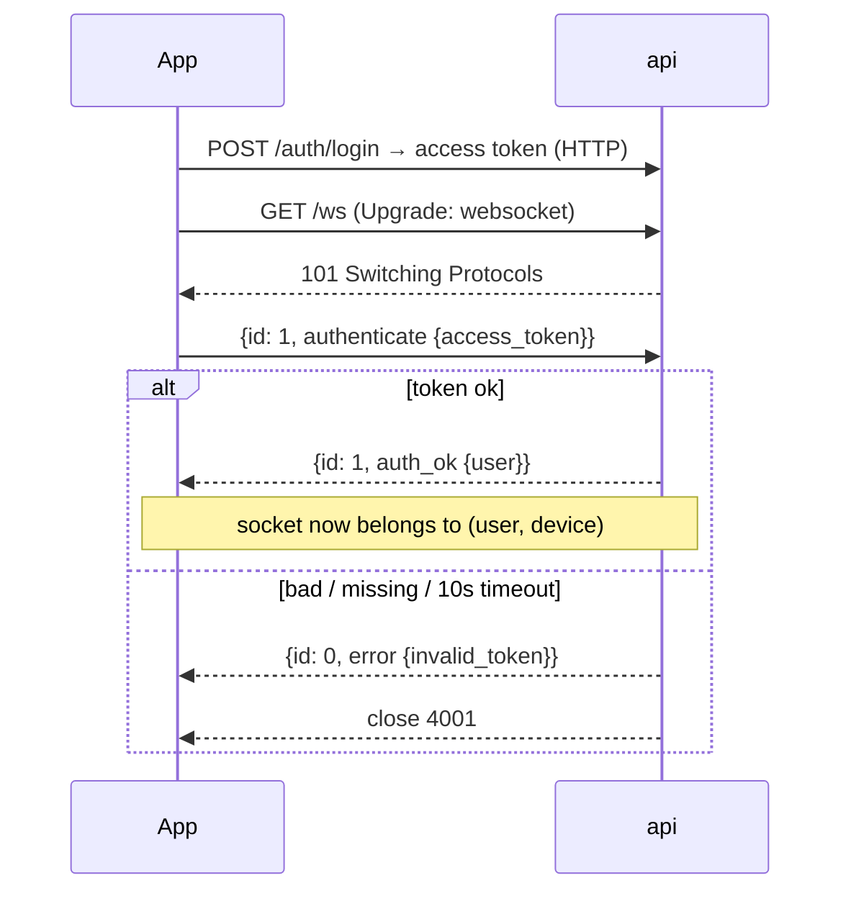

# Protocol

## Two pipes

| Pipe      | Carries                                             | Format                    | Transport                |
| --------- | --------------------------------------------------- | ------------------------- | ------------------------ |
| **Data**  | chat, events, presence, API, call setup (signaling) | **Protobuf**              | WebSocket / HTTP         |
| **Media** | voice, video, screen                                | Opus / AV1 / H.264 in RTP | WebRTC (UDP, P2P or SFU) |

Protobuf is the "phone ringing". WebRTC is "the call".

## Why Protobuf

| Format                    | Pros                                                                   | Cons                      |
| ------------------------- | ---------------------------------------------------------------------- | ------------------------- |
| JSON                      | Readable, everywhere                                                   | Bigger, slower, no schema |
| **Protobuf**              | Small, fast, **schema → SDK codegen in any language**, safe versioning | Not human-readable        |
| MessagePack               | Binary JSON, easy                                                      | No schema                 |
| FlatBuffers / Cap'n Proto | Fastest                                                                | Complex, weaker ecosystem |

- For chat, size barely matters (~200 bytes either way). The real wins are **CPU** and the **schema**.
- `.proto` files are public, so anyone can generate a client or bot in one command.
- Dev mode: dump messages as JSON for debugging.

## REST for requests, WebSocket for live stuff

- **REST (HTTP + JSON)** for normal request → reply calls: `/auth/*`, `/me`, `/users/search`, files later, `/health`, `/metrics`.
  Easy to test with `curl`, cacheable, no socket needed.
- **WebSocket (`/ws`)** for things that are live or stream: messaging, chat sync on reconnect, pushes
  (`message_created`, presence), and later call signaling / streaming. Audio and video media itself goes over WebRTC.
- Rule of thumb: if the server never needs to push to you about it, it's REST.
- `/ws` is only the door: after the upgrade (HTTP `101`) there are no routes, just frames.
  A `match` on the payload type picks the handler (`features/gateway/handlers.rs`).

### REST endpoints

| Method + path                      | Reply                            | Notes                                                   |
| ---------------------------------- | -------------------------------- | ------------------------------------------------------- |
| `GET /me`                          | `{id, username, display_name}`   |                                                         |
| `PUT /me/username {username}`      | `{id, username, display_name}`   | `409 username_taken`                                    |
| `GET /users/search?q=mon&limit=20` | `[{id, username, display_name}]` | prefix match, case-insensitive, excludes you; see below |

**User search:** `q` is 1–32 chars (letters, numbers, `_`, `.`), else `400 invalid_query`.
`limit` defaults to 20, max 50. Sorted by username. Users without a username never show up.
Never returns email. Rate limited to 30 per 10s per user (`429`). Uses the `users_username_prefix_idx` index.

### Frames

- Every WebSocket message is **one binary protobuf `Envelope`** (`proto/v1/envelope.proto`).
- An `Envelope` has an `id` and exactly one payload (`oneof`).
- **Request → reply:** the client numbers its requests (1, 2, 3…); the reply carries the **same `id`**.
  Replies can arrive in any order, so the client keeps a map `id → waiting promise`.
- **Push:** `id = 0`. The server tells you something happened (e.g. `message_created`).
- **Errors:** an `error { code, message }` frame with the request's `id`. Same codes as HTTP (`user_not_found`, …).

### Connecting



- **The first frame must be `authenticate`.** Browsers can't set headers on a WebSocket, so the token goes in a frame.
- Close codes. Before each close the server sends `{id: 0, error {code}}` with the same reason.

  | Code | Reason            | When                                 | Client does                          |
  | ---- | ----------------- | ------------------------------------ | ------------------------------------ |
  | 4001 | `invalid_token` … | bad, missing or late `authenticate`  | stops, shows the error               |
  | 4002 | `token_expired`   | access token ran out, no re-auth     | refreshes the token, reconnects now  |
  | 4003 | `session_revoked` | device logged out or revoked         | clears the session, goes to `/login` |
  | 1011 | `unavailable` | server couldn't check revocation (DB down) | reconnects with backoff |
  | else | —                 | network drop, server restart         | reconnects after 1s, 2s, 4s… (max 30s) |
- After auth, the socket remembers `(user_id, device_id)`; later frames don't carry the token.
- **Re-auth:** send `authenticate {access_token}` again on the open socket to move its expiry. The token must be for the same user and device, or the reply is `error {wrong_session}` and the old expiry still applies. The app does this about 25s before expiry.
- **Revoke:** the socket listens on NATS `device.<device_id>.revoked` and closes with 4003 when a message arrives. It also checks `devices.revoked_at` once at connect, after the NATS subscribe is confirmed. Revoke and expiry win over a pending request. See [identity-auth.md](identity-auth.md#logout).

### Requests

| Client sends                                      | Reply                          | Notes                        |
| ------------------------------------------------- | ------------------------------ | ---------------------------- |
| `authenticate {access_token}`                     | `auth_ok {user}`               | first frame; again to re-auth |
| `ping`                                            | `pong`                         |                              |
| `open_dm {username}`                              | `conversation`                 | creates it the first time    |
| `list_conversations`                              | `conversations`                | newest activity first, with your own unread counts (see [dms.md](dms.md#list-order-and-unread)) |
| `mark_read {conversation_id, seq}`                | `read_state_updated {conversation_id, last_read_seq, unread_count}` | only moves forward; also pushed to **your own** sockets, never to others |
| `create_group {name, usernames, nonce}`           | `conversation`                 | `nonce` optional (≤ 64): a retry returns the same group |
| `add_member` / `leave_group` / `rename_group`     | `conversation`                 | safe to retry: adding a member twice or leaving twice is not an error |
| `send_message {conversation_id, content, nonce}`  | `message_ack {nonce, message}` | see [dms.md](dms.md#sending) |
| `get_history {conversation_id, before_id, limit}` | `history` (newest first)       | limit default 50, max 100    |
| `sync {conversation_id, after_seq}`               | `sync_result`                  | also edits + deletes         |
| `edit_message {conversation_id, message_id, content}` | `edit_message_ack {message, seq}` | author only, see [dms.md](dms.md#edit-and-delete) |
| `delete_message {conversation_id, message_id}`    | `delete_message_ack {…, seq}`  | author only, hard delete     |
| — (push, id 0)                                    | `message_updated` / `message_deleted` | carry the change's `seq` |
| — (push, id 0)                                    | `message_created`              | live, via NATS (see dms.md)  |
| `call_start` / `call_accept` / `call_decline` / `call_join` / `call_leave` | `call_result` / `call_joined` | voice, see [calls.md](calls.md) |
| — (push, id 0) | `call_incoming` / `call_updated` / `call_ended` | voice calls |
| — (push, id 0)                                    | `friend_updated {user, state}` | see [friends.md](friends.md) |
| `start_typing {conversation_id}` (id 0)           | — none                         | fire-and-forget, see [dms.md](dms.md#typing-indicator) |
| — (push, id 0)                                    | `typing_started {conversation_id, user_id}` | to the other members |
| `set_idle {idle}`                                 | `pong`                         | see [presence.md](presence.md) |
| `get_presence {user_ids}`                         | `presences`                    | friends + DM members only, max 200 per request (client pages) |
| — (push, id 0)                                    | `presence_updated {user_id, status}` | see [presence.md](presence.md) |

Example session (written as JSON; on the wire it's binary protobuf):

```text
→ { id: 4, send_message: { conversation_id: 42, content: "hi", nonce: "a7f3" } }
← { id: 4, message_ack: { nonce: "a7f3", message: { id: 9002, seq: 44, ... } } }
← { id: 0, message_created: { message: { id: 9003, seq: 45, content: "ok" } } }   // push
```

### On the wire

`{id: 5, ping}` is 4 bytes: `08 05 52 00`. Each field is `(field number << 3 | wire type)` then its value,
so **field numbers are the real names on the wire**: never change or reuse one, renaming is free.

Test it end to end: `pnpm --filter mock smoke:ws` (api + stack running).

## Event sync (reconnect)

- Every message in a conversation gets a **sequence number** (`seq`).
- On reconnect, per conversation: `sync {after_seq: 5000}` → every message after #5000, **oldest first**.
- Nothing new? Answered from the conversation row (`last_seq`), no message read.
- At most 200 per sync. More missed → `complete: false`: you got the newest 200; drop your local copy and load older with `get_history`.
- Holes in seq (a crashed send) are fine: sync filters `seq > after_seq`, it doesn't count.
- Edits and deletes take a seq too, so sync also returns `edited` + `deleted_ids`, and `last_seq` to use next time.

## Versioning

- Protobuf: only add fields, never reuse field numbers.
- Clients send their protocol version on connect.

## Open questions

- Exact versioning policy between hub, nodes and old clients.
