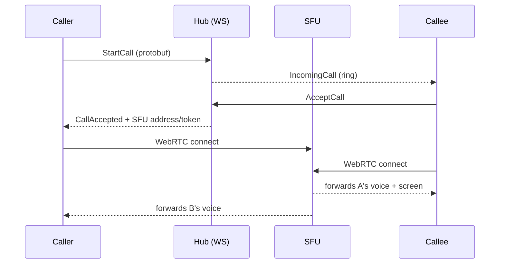
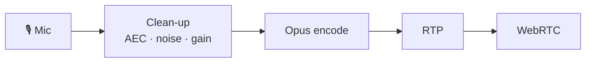
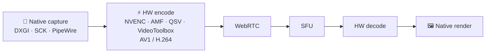

# Voice and video

## Transport: WebRTC (decided)

- **Client:** Google libwebrtc via LiveKit's Rust crates. Includes TURN client, jitter buffer, echo cancellation, congestion control.
- **Server (SFU):** `str0m`. Only forwards packets, so it needs none of the audio/codec parts.
- Both behind a `MediaTransport` trait.
- **Gate:** a prototype must carry our own hardware-encoded 60fps video through libwebrtc.

**MVP is server-only:** every call goes through our SFU. P2P comes later.

|                                                                    | WebRTC                      | QUIC (raw / Media over QUIC)      |
| ------------------------------------------------------------------ | --------------------------- | --------------------------------- |
| NAT traversal                                                      | ✅ built in (ICE/STUN/TURN) | ❌ build it ourselves (or `iroh`) |
| Real-time media (congestion control, jitter buffer, loss recovery) | ✅ built in                 | ❌ build it ourselves             |
| Simulcast, E2E (SFrame), web client                                | ✅                          | Partial / immature                |
| Complexity                                                         | Heavy legacy (SDP)          | Clean, modern                     |

QUIC would mean months of building the media layer ourselves. Rejected for now.

## Two paths

| Where                           | Transport              | Our cost       |
| ------------------------------- | ---------------------- | -------------- |
| DMs and groups (≤ 5), after MVP | **P2P**                | ~0 (TURN only) |
| MVP (everything)                | **SFU** on our servers | Our bandwidth  |
| Servers (later)                 | **SFU** on the node    | Node bandwidth |

- **SFU:** a server that receives one stream and forwards it to N people without decoding it.
- **TURN** (coturn): relay when P2P fails. ~10–20% of connections. Needed once P2P arrives (not in the MVP).
- **Simulcast/SVC:** send several qualities, and each viewer gets what they can handle.

## Call setup (signaling)

MVP: media always goes through the SFU. After the MVP, 1-on-1 calls can connect P2P instead.

## Audio pipeline

**Sender:**

1. Capture at 48 kHz with `cpal`.
2. Clean-up (each one a **user setting**, all on the sender's machine):
   - Echo cancellation (must be on the sender: it needs to know what your speakers play)
   - Noise suppression: Off / Light (RNNoise, `nnnoiseless`) / Strong (DeepFilterNet)
   - Auto gain
   - Voice activity or push-to-talk
   - libwebrtc already includes Google's echo cancellation and noise suppression. Don't write our own.
   - Check `nnnoiseless` maintenance before relying on it.
3. Opus encode, 20 ms frames.

**Receiver:**

- Jitter buffer reorders and smooths packets.
- Loss handling: Opus PLC (guesses lost audio) and FEC (redundant data).
- **Mixing is on the receiver** (each voice arrives separately in P2P). This gives per-person volume and mute.
- Optional receiver-side "normalize everyone".

Mouth-to-ear target: 50–150 ms.

| Use                         | Opus bitrate        |
| --------------------------- | ------------------- |
| Normal voice (free servers) | 64 kbps             |
| HQ voice (DMs, premium)     | 96–128 kbps         |
| Music / stream audio        | 256–510 kbps stereo |

**Screen-share audio:** a second track, captured from the system (WASAPI loopback / ScreenCaptureKit / PipeWire). Stereo, high bitrate, **no** noise suppression.

## Video pipeline

- **Everything runs in the Rust core, never in the webview.** This avoids WebKitGTK's weak WebRTC on Linux and keeps the 60fps hardware path.
- **Native rendering:** getting decoded frames on screen fast. **Riskiest piece: prototype first** and compare approaches (shared GPU texture into the webview vs a native surface over it). Native overlays risk z-order bugs (menus hidden behind video) and click-through issues.

## Reference bitrates

- Voice: ~29 MB/h at 64 kbps (~43–58 MB/h at 96–128 kbps).
- Screen 1080p60: ~3.6 GB/h **per viewer**. ~125x voice at 64 kbps.

## Quality promise

- 1-on-1: 60fps source quality.
- Groups: start at 720p60, scale up if bandwidth allows.

## Open questions

- Call lifecycle: ringing, busy, declined, timeout, screen share on/off mid-call, reconnect after network change.
- Default codec without hardware AV1.
- Native rendering approach (pending prototype).

## Risks

- Hardware encode varies a lot per GPU and OS, so a software fallback is needed.
- Latency vs quality: games need low latency.
